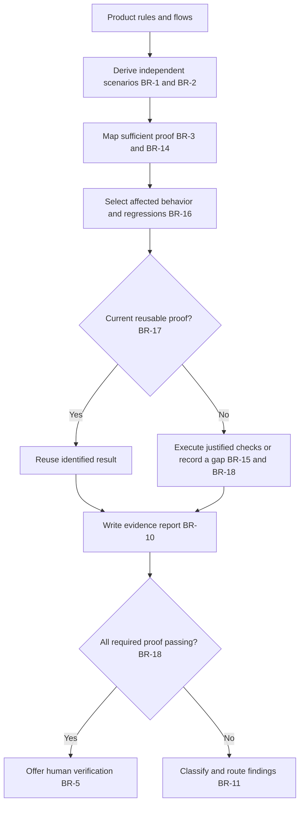
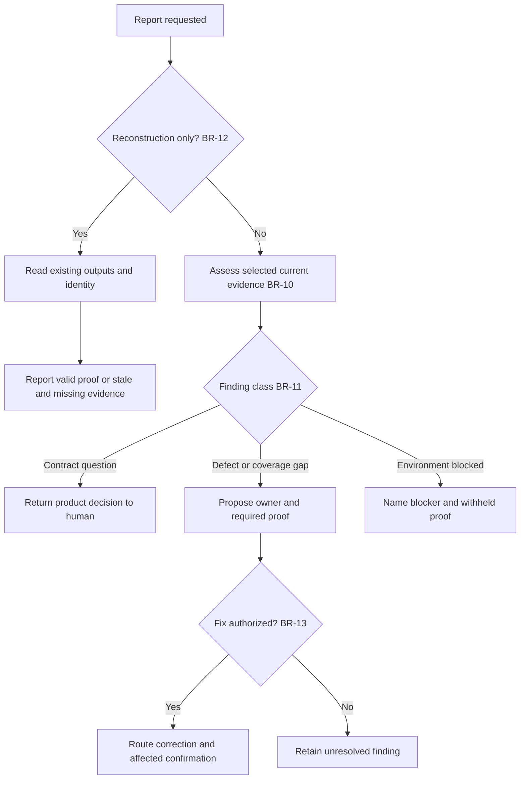
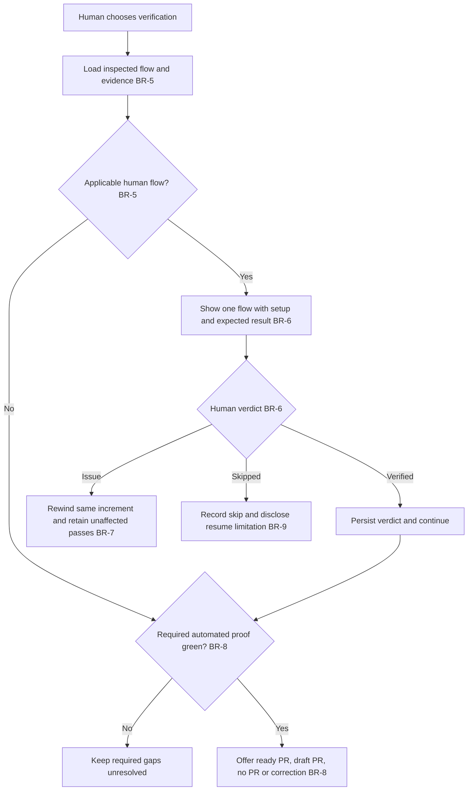

# Behavior Validation and Human Acceptance

## What

Hele derives independent acceptance scenarios from product rules, selects the smallest sufficient proof for them, and reports current results, failures and missing evidence. It can reuse valid engineering results, execute justified journeys, reconstruct reports from existing outputs, and route authorized corrections to the appropriate owner.

The human separately checks the changed experience through short guided flows and supplies explicit verdicts. Automated results do not stand in for a human verdict, and a human pass does not erase an automated coverage gap. This description records the shipped skills and templates; it does not claim that every conversational branch has been executed successfully.

## Why

The scenario-authoring instructions explicitly keep expectations independent of the implementation plan so tests do not merely confirm the chosen solution. The validation strategy separates behavior from technical proof and execution policy: the objective is sufficient evidence without duplicating browser tests or rerunning valid checks unnecessarily. Human verification checks the changed experience rather than every parameter combination. The sources require honest gaps and measurements rather than invented green results or CI savings. Motives for individual report formatting choices are not recorded separately.

## Flows

### Define behavior and assess evidence

Scenarios come from the current product contract before test implementation is inspected. QA then maps proof and selects execution based on the actual behavior and affected regressions.

| Branch | Rule |
|---|---|
| Expectations precede reading implementation proof | BR-1, BR-2 |
| Coverage recommendations specify the sufficient level and owner | BR-3, BR-14 |
| Selection includes affected cross-feature regressions | BR-16 |
| Relevant unchanged identity allows reuse | BR-17 |
| Missing proof requires execution or an explicit non-passing status | BR-15, BR-18 |
| Green required scope can proceed to a separate human decision | BR-5, BR-18 |
| Failed or missing proof is reported and routed | BR-10, BR-11 |

### Resolve findings or reconstruct a report

The report distinguishes product defects, missing coverage, test defects, contract questions and environmental blockers. Reconstructing a missing report uses available evidence rather than inventing a new run.

| Branch | Rule |
|---|---|
| Reconstruction does not rerun tests merely to recreate a file | BR-12 |
| Every result distinguishes evidence from missing or stale proof | BR-10, BR-12 |
| Finding type determines the owner or required human decision | BR-11 |
| Implementation follows authorization rather than the recommendation alone | BR-13 |

### Collect human verdicts

Prepared flows disclose whether they were executed. The human marks each shown flow verified, skipped or problematic. Corrections preserve unaffected verified flows, while skipped-flow resumption has a recorded contract ambiguity.

| Branch | Rule |
|---|---|
| No applicable human experience permits a backend-only close path | BR-5 |
| Verdicts are supplied explicitly by the human | BR-6 |
| An issue returns to the same increment without losing unaffected passes | BR-7 |
| A skip is represented separately from a pass | BR-9 |
| Closing requires the required automated evidence as well as resolved flow handling | BR-8 |

## Business rules

### BR-1 — Derive acceptance independently

Acceptance scenarios are derived from the product description and its slice map before inspecting test implementation and without using the execution plan as the source of expected behavior. Every testable business rule and named flow receives Given/When/Then coverage, including implied denials, boundaries and unhappy branches. A rule without a mapped scenario has an explicit explanation. The scenarios describe product behavior rather than a component, storage structure or endpoint.

### BR-2 — Preserve scenario identity and meaning

Existing scenario IDs survive patches. A changed expectation is rewritten in place rather than appended as conflicting history. Intentionally removed behavior retains its identity with explicit retirement and supporting product-rule approval; being blocked is not evidence that behavior is obsolete. Each scenario references its originating three-digit increment and business rule. New or changed behavior starts pending until supported by current execution evidence.

### BR-3 — Separate scenarios from coverage recommendations

Technical proof choices belong in a separate Coverage mapping, with test level, owner, existing or proposed proof, assertion, real or mocked boundary, rationale and execution scope. Proposed tests are labeled proposed. One scenario can require several tests, and one journey can prove several scenarios only when the relevant assertions are identified. Source inspection is not a passing run.

### BR-4 — Keep acceptance documents aligned with the product

Scenario documents record their version and product-description basis, update the registry, and join the product-description approval stop. Coverage recommendations do not add a separate approval stop. Scenario authoring does not create an early human-verification artifact. Changes and retirements must agree with the current product rules and their approval decisions.

### BR-5 — Prepare human flows from inspected facts

QA prepares short flows for the changed human experience from inspected setup and product expectations. Each flow provides where to open, necessary data and individual steps with expected results, and says whether the walk was executed or prepared but not executed. Unit or API proof does not imply a UI walk. Missing setup is a named blocker; credentials and environment facts are not invented. Backend-only work can report no applicable human flow, but still needs required automated evidence before normal close.

### BR-6 — Keep human verdicts explicit

The human is shown one flow at a time, beginning with happy paths and then risky unhappy paths, and chooses verified, issue or skipped. Automated results cannot mark a human flow verified. A verdict is recorded for the flow that was shown, rather than inferred for other flows or all parameter combinations.

### BR-7 — Preserve unaffected passes through correction

A reported defect stops the human walk and returns to the product-definition and delivery flow for the same increment. It does not create a new increment merely because verification found a problem. Previously verified flows remain verified and are not walked again unless the correction affected them. Other flow sections are refreshed from the current QA report.

### BR-8 — Require evidence before normal closure

Normal closure requires passing automated evidence for the required scope and no open required QA gaps. A human pass does not override a failed assertion or missing required proof. Once flow handling is complete, the human can choose a ready PR, draft PR, no PR, or another correction. The ready-PR closure follows CI; the no-PR choice does not push. These choices are part of guided delivery's shared closing contract, not automatic publication by QA.

### BR-9 — Record the skipped-flow continuation limitation

The verification contract permits a skipped verdict, but its continuation wording alternates between the next flow not verified and the first pending flow; another condition describes all remaining flows as verified. A literal implementation could therefore revisit a skipped flow. The approved absorption preserves this ambiguity and does not claim that skip/resume behavior has been validated or silently redefine skipped as verified. Sources are `skills/hele-verify-work/SKILL.md` phases 1–3 and `templates/verify.md` verdict rules.

### BR-10 — Write current, reviewable evidence reports

Every QA assessment produces a readable report, including runs with zero E2E, failures or blockers. Required behaviors map to current proof or an explicit gap. Results identify scenario and rule titles, assertions, boundaries, command and result, code identity, environment and relevant output. Fresh execution and reused evidence are distinguished. Historical unaffected statuses are not presented as new execution. A report never derives green merely from a test file, screenshot, mock or old CI result.

### BR-11 — Classify findings and preserve ownership

Findings state evidence, impact, owner and the validation still needed. They distinguish product bugs, coverage gaps, test defects, contract questions, polish and blocked work. Product defects and missing smaller-test coverage belong to the relevant engineers; Wylie fixes his own E2E code. Contract questions return to the human without weakening expectations to fit current behavior. Environmental blockers name the unavailable proof. Assessment beads close after the report is recorded; actionable fix beads remain open until resolved.

### BR-12 — Reconstruct reports without fabricated reruns

Report reconstruction reads available outputs, mappings, code revision, task records and traces. It does not run tests merely to recreate the report. Stale or missing evidence remains explicitly non-passing. Initial failures and retries remain visible; a later green retry alone does not dismiss the initial failure or establish its cause.

### BR-13 — Route authorized fixes and retain the QA decision

The QA report offers continuation to human verification or correction, and adds choices for failed checks, coverage gaps and contract decisions when necessary. Recommendations identify owners and affected confirmation scope; they do not authorize implementation by themselves. Approved corrections enter the existing build-and-confirm flow. The actual build loop belongs to guided delivery. Absorption uses this feature's evidence rules but excludes normal fix routing and the manual walk, as defined by product-absorption.

### BR-14 — Choose the smallest sufficient proof

Choose unit, component, integration, API E2E or browser E2E based on the failure the proof must detect, not the importance of the requirement alone. Inspect actual assertions, fixtures and dependency boundaries. Describe real versus mocked connections explicitly; neither a browser nor an API label establishes the level on its own. Required proof must detect the relevant failure at a justified scope.

### BR-15 — Justify E2E and reuse journeys

An E2E recommendation identifies the real connection, a failure smaller tests miss, and why an existing journey is insufficient. Reuse an existing journey before extending it, and extend before adding one. Do not mock the connection being proved or merge unrelated journeys into a giant test. Zero new E2E is valid when sufficient evidence exists; selected existing affected journeys still require proof.

### BR-16 — Select affected regressions across features

Execution includes new or changed behavior and affected regressions across feature boundaries. Selection uses the project's execution map, dependencies or traces and explains the relationship. Shared changes or uncertainty broaden the scope. An increment tag alone cannot establish that other features are unaffected. Coverage recommendations and execution selection remain distinct decisions.

### BR-17 — Reuse evidence only while relevant identity remains valid

Engineering or confirmation results can be reused only while the relevant code, fixtures, dependencies and environment remain unchanged. A reused result retains its original command, output and identity and is labeled reused. A change that invalidates the proof requires a new relevant check; historical green alone is insufficient.

### BR-18 — Make result status follow proof

| Status | Required meaning |
|---|---|
| Passing | All mapped assertions for the required behavior have current relevant execution evidence |
| Pending | Required proof has not been supplied or executed |
| Blocked | A named environmental or external obstacle prevents the required proof |
| Failing | An executed required assertion failed |

All required scope must pass for green. Missing coverage retains an owner and remains visible. Neither source inspection nor human acceptance can convert a pending, blocked or failing required check into passing.

### BR-19 — Separate coverage from CI policy and measurement

CI selection is distinct from deciding what behavior deserves coverage. Existing blocking gates remain until a concrete replacement or selector, including a broad-change fallback, is validated. Execution mapping records commands, areas and dependencies, owners, triggers, stages and measured runtime, using the project's existing mapping location or `tests/TEST_EXECUTION.md` when absent. Proposed faster PR checks require real scheduled or release coverage with owners and explicit tradeoffs; Rigsby owns implementation of CI changes. Proposals are never described as an already-running system. Pipeline wall-clock, setup, retries and test durations are reported separately; unknown cost stays unknown and parallel test durations are not promised as additive time savings.

### BR-20 — Keep screenshots useful and bounded

Screenshots are optional evidence for a useful visible change or failure, not a quota or a replacement for assertions. Kept captures show the relevant settled element, use inspected 1920×1080 paletted PNGs without resizing, and respect the configured retention ceiling. Overflow is chat-only scratch. Do not fabricate a before image or boot an app solely to populate a report. Zero screenshots is valid when no screenshot adds useful evidence. Routine QA does not prune unrelated suites; the separate E2E-audit capability assesses those changes.

## Scope

### In scope

- Independent scenario authoring, stable identifiers and explicit proof mapping.
- Current evidence, sufficient test levels, affected regression selection and valid result reuse.
- Honest failure classification, report reconstruction, fix proposals and ownership.
- Prepared human walks, explicit verdicts and preservation of unaffected passes.
- CI-policy recommendations, measured limits and useful optional screenshots.

### Out of scope

| Left out | Why |
|---|---|
| Product implementation and feature-build orchestration | Guided delivery owns those actions |
| Automatically approving fixes or product-rule changes | The report preserves the human's decision and existing approval boundaries |
| Pruning an unrelated E2E suite during routine QA | Existing-suite auditing is a separate capability |
| Treating static workflow text as execution evidence | Skills describe the contract; current runs must demonstrate compliance |
| Resolving the skipped-flow ambiguity during absorption | The approved snapshot records the existing limitation without product changes |

## Glossary

| Term | Meaning |
|---|---|
| Acceptance scenario | A product-language Given/When/Then expectation with a stable identity |
| Current evidence | An executed assertion tied to relevant code and environment identity that remains valid |
| Prepared walk | A documented human flow whose execution has not been claimed |
| Coverage gap | Required behavior without sufficient mapped proof |

## Changelog

- v1.0 (2026-11-18) — absorbed from the app. Slices: 001-define-acceptance-scenarios (BR-1, BR-2, BR-3, BR-4); 002-guide-human-acceptance (BR-5, BR-6, BR-7, BR-8, BR-9); 003-report-and-resolve-failures (BR-10, BR-11, BR-12, BR-13); 004-select-sufficient-current-proof (BR-14, BR-15, BR-16, BR-17, BR-18, BR-19, BR-20).
