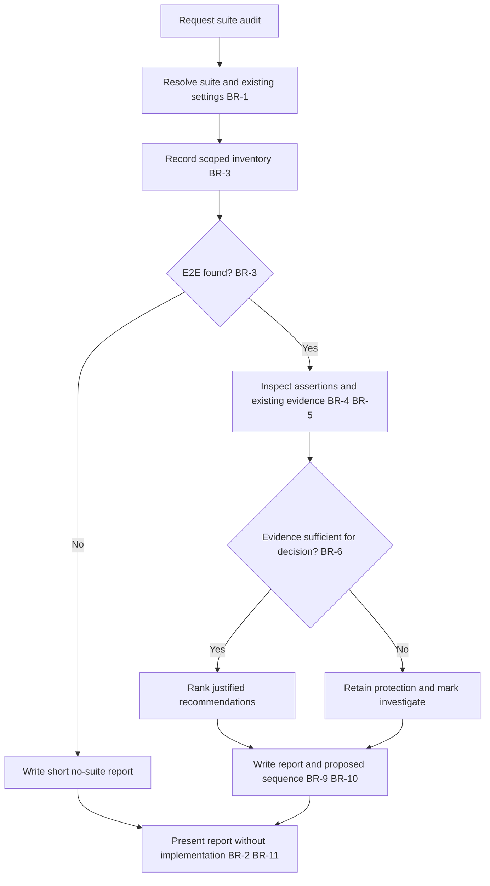
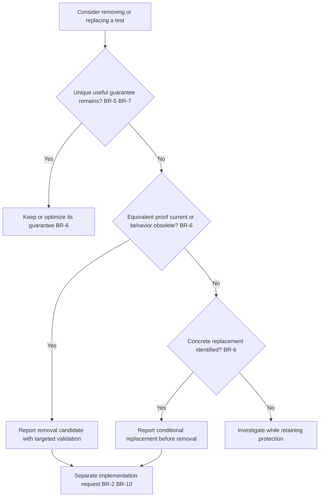

<!-- RULES:
- Written as STATE, not history: it describes how the product works TODAY.
  A superseded rule is REWRITTEN in place, never appended below the old one.
- Patch-only versioning (1.0 → 1.1 → 1.2). A ground-up rebuild is a NEW
  feature folder (<slug>-v2), never a major bump here.
- Every edit bumps the patch version, updates `updated`, adds a changelog line.
- Human-readable markdown ONLY. No XML section tags. A person opens this file
  and understands the product: what, why, flows, rules, scope. Agents find
  sections by the ## / ### headings below.
- Written only after every product question is answered. No Open
  questions section. A question still open means do not create this
  file (new feature) and do not patch it (update). Useful questions
  land in one pack before this file exists (accept all / one by one /
  open reply). A recommendation belongs in that pack, not in a rule
  written ahead of the answer.
- Business rules are numbered (BR-n) and testable — TEST_STUBS reference them.
  Each rule is a ### BR-n — Title heading with enough prose to review alone.
- Each named flow: ### caption, then a short prose paragraph, then the mermaid,
  then a Branch | Rule table listing every BR-n that governs a branch in THAT
  diagram (not a dump of all rules). Keep BR-n on mermaid edges/nodes too.
- Written in English, like every artifact.
-->
---
feature: e2e-audit
doc: PRODUCT_DESCRIPTION
version: "1.0"
status: approved
updated: 2026-11-18
---

# Existing E2E Suite Audit

## What

A person can ask Hele to review an existing E2E suite's coverage and cost and receive a ranked, evidence-based recommendation report. The audit identifies useful guarantees, overlapping proof, missing evidence and potential sources of cost. It names prerequisites and verification steps before any proposed removal or replacement.

The audit is available without initialized Hele memory. Its deliverable is a report, not an implementation: tests, product code and CI remain unchanged. This capability is a shipped agent workflow contract; its presence in the source is not evidence that a live audit complied with every rule.

## Why

Slow or overgrown E2E suites can consume time without making the unique guarantees clear. The source skill explicitly protects useful coverage while examining setup, waiting, retries and serialization as possible cost drivers. A rarely failing test can still protect a costly regression. The report lets an engineer assess proposed improvements without reconstructing the investigation. More specific business priorities and quantified savings are not recorded and must not be invented.

## Flows

### Assess the requested suite

The audit establishes an honest scope, examines existing evidence, and reports either the reviewed suite or a clearly identified limitation. It does not start an expensive benchmark merely because timing data is missing.

| Branch | Rule |
|---|---|
| Run with or without existing project memory | BR-1 |
| No suite, complete scope or explicitly partial scope | BR-3 |
| Use existing evidence and inspect real guarantees | BR-4, BR-5 |
| Recommend a justified action or retain protection pending investigation | BR-6 |
| Produce a durable report and a proposed implementation sequence | BR-9, BR-10 |
| Handoff does not authorize implementation | BR-2, BR-11 |

### Evaluate a proposed cut

A similar name, a slow run or a low failure rate cannot establish that coverage is redundant. A replacement-dependent cut stays conditional until the surviving proof exists and has been validated.

| Branch | Rule |
|---|---|
| Examine assertions and real boundaries rather than labels | BR-5, BR-7 |
| Keep, optimize, remove, replace or investigate based on explicit guarantees | BR-6 |
| A proposed action remains separate work | BR-2, BR-10 |

## Business rules

### BR-1 — Audit independently of product setup

Use the suite named by the human, or the project's E2E suites when none is specified. Project settings apply when present; otherwise use plugin defaults. No `.hele/` initialization, design interview, Beads setup, PRD or product increment is required. A suite-audit request through the general conductor routes to this standalone audit.

Evidence: [SKILL.md](../../../skills/hele-fix-e2e/SKILL.md), opening/context and Establish the scope and baseline.

### BR-2 — Write only the audit deliverable

During the audit, do not edit tests, production code, dependencies, CI workflows, snapshots or quarantine settings. A recommendation is not authorization to apply it. A later request must identify the subset to implement; that work remains separate from the audit. The `fix-e2e` command name means finding the fix, not silently changing the suite.

Evidence: [SKILL.md](../../../skills/hele-fix-e2e/SKILL.md), opening and Write the decision report; [e2e-audit.md](../../../templates/e2e-audit.md), output contract.

### BR-3 — Make scope complete and limits visible

Inspect the runner configuration, tests, assertions, helpers, fixtures, mocks, browser/project matrices, CI and selection rules relevant to the declared scope. Record code identity and working-tree state, reviewed and excluded paths, runner, and declared versus expanded case counts when known. For large suites, work in batches by journey while maintaining one inventory. A sample must not be presented as the entire suite. Time/access limits produce an explicitly partial report naming unreviewed items. Finding no E2E is a valid short report and does not cause test creation.

Evidence: [SKILL.md](../../../skills/hele-fix-e2e/SKILL.md), Establish the scope and baseline; [e2e-audit.md](../../../templates/e2e-audit.md), Scope and baseline and Complete scoped inventory.

### BR-4 — Reuse available evidence before requesting measurement

Use existing result artifacts and accessible CI logs for timing, retries, flakes and setup costs. Do not boot the stack, install packages or run a full expensive suite merely to audit it. Missing measurements stay unknown and include an exact scoped follow-up command. A separately requested benchmark can run within its agreed scope; the audit itself does not imply that permission.

Evidence: [SKILL.md](../../../skills/hele-fix-e2e/SKILL.md), Establish the scope and baseline.

### BR-5 — Inspect the behavior and connection behind each assertion

For every test or coherent parameterized group, record the behavior, real connection, relevant role/state/device/timing distinctions, exercised and mocked dependencies, equivalent smaller or E2E assertions, unique failure modes, owner/stage and measured cost when available. Use existing PRDs or recorded documentation, behavior, tests and incident history as context. Do not invent business priorities. Cite exact test titles and assertion locations; visiting the same screen or having a similar name does not prove equivalent coverage. Uncertain intent remains an explicit limitation in the audit report.

Evidence: [SKILL.md](../../../skills/hele-fix-e2e/SKILL.md), Evaluate coverage before recommending cuts; [e2e-audit.md](../../../templates/e2e-audit.md), Evidence behind each recommendation.

### BR-6 — Support each primary recommendation with surviving guarantees

Each test or coherent group receives one primary recommendation with the following evidence:

| Recommendation | Required justification |
|---|---|
| Keep | Name useful unique coverage and the regression that would escape without it |
| Consolidate | Name the surviving journey and assertions, retaining independent failure diagnosis rather than joining unrelated flows |
| Replace at a lower level | Name the smaller scope, real boundary and missing assertions; replacement must be implemented and validated before E2E removal |
| Remove | Show equivalent current surviving proof or evidence that the behavior is intentionally obsolete |
| Optimize | Preserve useful guarantees while addressing demonstrated setup, waits, fixtures, retries, login, serialization or configuration cost |
| Investigate | Retain protection while intent, equivalence, failure cause or timing is uncertain |

An unexecuted replacement is not a ready removal. Ready candidates still require targeted validation when applied. Conditional cuts and decisions to retain tests must be visible rather than omitted from the report.

Evidence: [SKILL.md](../../../skills/hele-fix-e2e/SKILL.md), recommendation table and Write the decision report; [e2e-audit.md](../../../templates/e2e-audit.md), Recommended actions.

### BR-7 — Reject misleading proxies for test value

Do not recommend removal solely because a test is slow, flaky, old, rarely failing or has never failed. Distinguish test defects from product races and environment failures. Describe actual boundaries: API tests are not automatically integration tests, and browser tests are not automatically E2E. Device, role or state differences that preserve a distinct guarantee cannot be erased merely to reduce counts.

Evidence: [SKILL.md](../../../skills/hele-fix-e2e/SKILL.md), Establish the scope and baseline and Evaluate coverage before recommending cuts.

### BR-8 — Keep cost claims traceable and dimensionally honest

Separate pipeline wall-clock, job time, execution, environment startup, browser installation, retries and parallelism. Summed parallel test durations do not equal pipeline savings. Mark facts, estimates, hypotheses and unknowns distinctly and cite measurements. Do not invent savings, automatically flatten a browser matrix, or demote a blocking check as an optimization. Historical failure rates are context rather than a complete measure of test value.

Evidence: [SKILL.md](../../../skills/hele-fix-e2e/SKILL.md), baseline and report sections; [e2e-audit.md](../../../templates/e2e-audit.md), Scope and baseline and Cost and uncertainty.

### BR-9 — Produce a durable and reviewable report

Use `.hele/reports/E2E_AUDIT.md` for an initialized project, `E2E_AUDIT.md` at the project root otherwise, or the human's chosen output. Read an existing report first; refresh the same scope/revision history while preserving unresolved decisions. Follow the audit template. Lead with diagnosis, confidence, limits and highest-value actions; include complete scoped inventory, evidence and prerequisites for every recommendation. Explicitly say when there are no safe cuts. Include uncertainty and follow-up measurements instead of leaving unsupported claims implicit.

Evidence: [SKILL.md](../../../skills/hele-fix-e2e/SKILL.md), Write the decision report; [e2e-audit.md](../../../templates/e2e-audit.md), Assessment, inventory, follow-up measurements and Audit history.

### BR-10 — Propose implementation in evidence-preserving order

The report orders follow-up as replacement proof, validation, removal/consolidation, justified CI selection changes, then measurement. Name verification commands, owners, independently applicable actions, dependencies and rollback. A proposed CI selector requires explicit mappings, broad-change fallback, blocking stage, actual scheduled/release trigger and owner. Preserve existing gates until the replacement is validated. This sequence describes future implementation and does not claim that it ran.

Evidence: [SKILL.md](../../../skills/hele-fix-e2e/SKILL.md), Write the decision report; [e2e-audit.md](../../../templates/e2e-audit.md), Implementation sequence and Validation before removal.

### BR-11 — Keep final ownership and handoff explicit

Wylie performs the assessment and owns the final report. Rigsby may investigate CI separately within configured concurrency and report-ownership limits; Wylie incorporates the findings. Present a concise diagnosis, ranked recommendations and a report link in the chat language, state that only the report was written, and disclose partial scope. A separately requested application assigns smaller tests to their owning engineers, E2E work to Wylie and CI work to Rigsby, with replacement proof before removal.

Evidence: [SKILL.md](../../../skills/hele-fix-e2e/SKILL.md), dispatch paragraph and final report/handoff paragraphs.

## Scope

### In scope

- Read-only assessment of the requested E2E suite and its CI cost context.
- Complete scoped inventory, assertion-level coverage comparison and honest measurement limits.
- Ranked recommendations, prerequisites, surviving guarantees and a reviewable implementation proposal.
- Report refresh preserving unresolved decisions and scope/revision history.

### Out of scope

| Left out | Why |
|---|---|
| Editing or removing tests, product code or CI | Audit recommendations require a separate implementation request |
| Automatic expensive benchmarking or stack setup | The audit reuses evidence and names missing measurements |
| Creating product PRDs or initializing project memory | The audit is standalone |
| Invented business priorities or savings | Claims require recorded evidence |
| Successful live audit compliance claimed from source text | Runtime proof belongs in QA reports; help discovery alone is insufficient |

## Glossary

| Term | Meaning |
|---|---|
| Current surviving proof | Existing, relevant evidence that the guarantee remains protected after a proposed cut |
| Conditional cut | Removal or consolidation dependent on replacement proof, assertion movement or a product decision |
| Scoped inventory | Every test/group and material matrix distinction included in the declared audit boundary |

## Changelog

- v1.0 (2026-11-18) — absorbed from the app. Slices: 001-audit-existing-suite (BR-1–BR-11).
