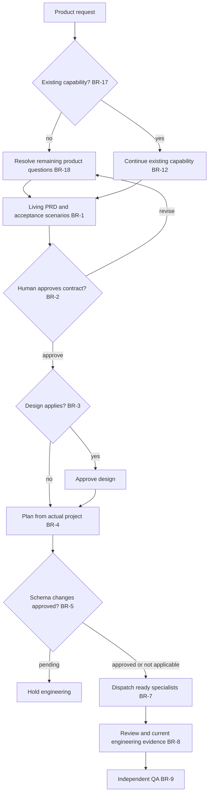
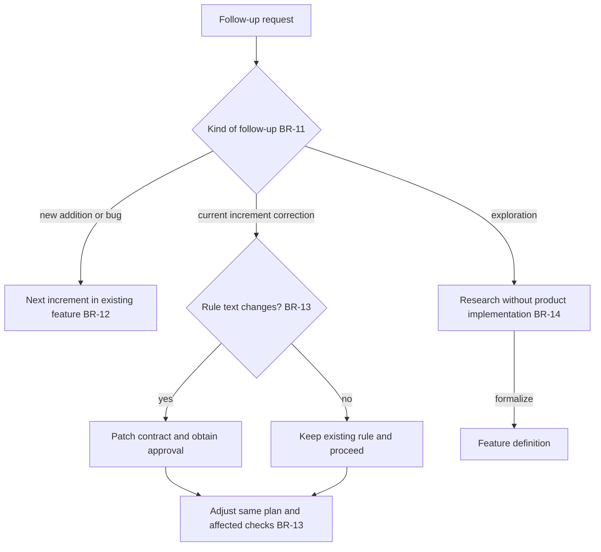
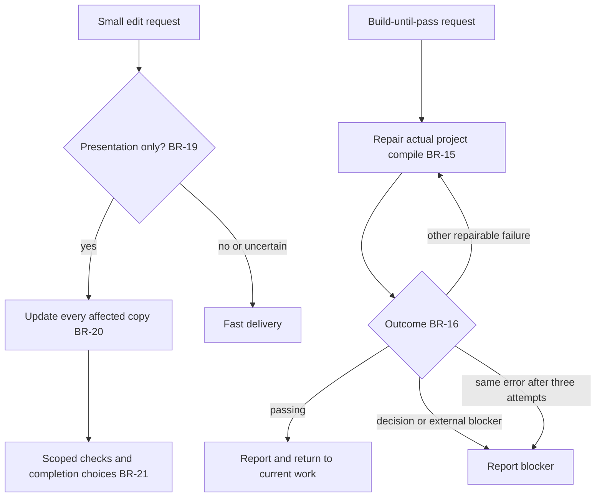

# Guided Product Delivery

## What

Hele turns a person's product request into a living specification and a coordinated delivery by named specialists. The conversation keeps the current work in scope across questions, implementation, review, automated evidence and human feedback. Small additions, bugs, exploratory work and presentation-only changes take different paths through that process.

This product is implemented as agent instructions and document templates. The rules below describe the shipped workflow contract; their presence in source does not prove that a model has executed them correctly. Known contradictory instructions remain explicit rather than becoming invented guarantees.

## Why

The documented purpose is to preserve product decisions between sessions while separating product ownership, engineering and independent validation. The open-channel contract keeps the person's conversation available while specialists work. Targeted verification and concurrent independent reviews avoid redundant machine work and unnecessary serialization. Database proposals expose migration risk before execution. These motives are stated in the Lisbon persona, open-channel template and build skill; other unstated motives are not recorded.

## Flows

### Define and deliver a feature

An idea becomes a reviewed product contract before engineering begins. Design and database decisions introduce their own applicable gates; the execution plan itself is not another approval stop.

| Branch | Rule |
|---|---|
| Resolve existing versus new work | BR-17, BR-12 |
| Answer questions before authoring | BR-18 |
| Approve or revise the product contract | BR-1, BR-2 |
| Include or skip design | BR-3 |
| Plan without an additional sign-off | BR-4 |
| Hold work for draft database changes | BR-5 |
| Dispatch and verify before QA | BR-7, BR-8, BR-9 |

### Continue or correct active work

A correction to the active increment stays in that increment and preserves unaffected human verdicts. New additions use the next increment; exploration stays outside implementation until formalized.

| Branch | Rule |
|---|---|
| Classify and retain session context | BR-11 |
| Add a new increment to existing work | BR-12 |
| Revise the active increment with or without changed rules | BR-13 |
| Keep exploration separate until requested | BR-14 |

### Apply a small edit or repair compilation

Presentation-only edits receive proportional checks. Compilation repair has a bounded outcome and returns to the existing product conversation.

| Branch | Rule |
|---|---|
| Qualify or escalate presentation work | BR-19 |
| Update copies and perform scoped checks | BR-20, BR-21 |
| Repair compilation without adding a feature | BR-15 |
| Stop or retry with a bounded outcome | BR-16 |

## Business rules

### BR-1 — One living product contract per capability

A new capability has a meaningful English slug, one current-state product description, stable numbered business rules, named flows and explicit scope. The first delivery has a numbered increment. The registry carries names, summaries, aliases and document versions, without a feature-progress status. Changed rules replace their previous wording with a patch version and changelog entry; a ground-up replacement is a new feature folder. Removed historical commands and phase-state files are not current product surfaces.

### BR-2 — Approve product behavior together with acceptance scenarios

The human reviews the product description and its independently derived acceptance scenarios at one approval stop. Scenario expectations come from the product contract rather than an implementation plan. Coverage recommendations accompany the scenarios without a separate strategy approval. An unapproved new or changed contract does not authorize normal implementation.

### BR-3 — Design participation is conditional

New screens or layout changes use the design workflow when the project enables it. Explicit no-design or backend-first work can skip design, with the reason recorded in the execution plan. Applicable design is approved before engineering; existing designs must match the approved contract. The detailed design contract belongs to `visual-design`.

### BR-4 — Planning does not add another approval stop

After applicable product/design approval, planning studies the actual project and records relevant files, existing patterns, approved document versions, task owners, dependencies and verification expectations. Missing or stale acceptance scenarios are reconciled before build. Each actionable delivery task has a Beads issue. The plan becomes ready and engineering starts without asking the human to approve the plan itself, subject to the database gate in BR-5.

### BR-5 — Database changes require their own decision

Schema, index, backfill and production-seed changes require Hightower's proposal and explicit approval. The numbered changes, risks and rollback appear in the plan. A draft proposal blocks initial build and unapproved migration tasks remain held. New queries against unchanged structures do not require this gate. Applied migrations receive conformance review and update the project database map.

### BR-6 — Assign specialists by responsibility

Lisbon owns the product and coordination; engineers implement. Security-relevant work includes Jane, database work includes Hightower and CI execution-policy implementation belongs to Rigsby. Named agents use the configured role/model selection and project concurrency limit. Claude Code is the shipped distribution. The strict instruction against using the session model conflicts with documented missing-key/`inherit` fallback; this Codex absorption is an adaptation, not evidence of native Codex support or resolution of that contradiction.

### BR-7 — Dispatch only ready, non-overlapping work

Workers run in the background. A dependent task waits for its dependencies to close, and tasks with overlapping declared files do not run together. In-flight workers stay within the configured limit. Independent tasks continue while Lisbon reviews completed work; review is not a global serialization barrier. Unexpected touched files are reported rather than silently broadening ownership.

### BR-8 — Engineering supplies current and proportional proof

Behavior tasks start from targeted failing proof at the smallest sufficient test level. Task contracts constrain expensive verification. Completion reports identify covered rules/scenarios, commands, outcomes, relevant code identity and environment. Final checks cover affected tests and applicable type/lint checks, broadening for shared configuration, lockfiles, setup/helpers, schema changes or uncertainty about impact. A file that contains a test, an old result or an unexecuted expectation is not a passing result.

### BR-9 — Completed engineering proceeds to independent validation

Engineering closes completed task records and its epic and marks the execution plan built only when the required current engineering evidence passes. It then starts independent QA without another plan/build approval. QA may still find product failures or missing proof; a built plan is not equivalent to final QA or human acceptance. Detailed evidence and acceptance behavior belongs to `behavior-validation`.

### BR-10 — Repair approved QA findings in the active increment

The QA-fix mode processes approved actionable findings in the same increment. Fixes that alter product meaning return to product definition rather than silently changing expectations. Valid confirmations can be reused; code changes invalidate affected confirmations. The final report is refreshed after repairs and preserves unresolved gaps.

### BR-11 — Keep the conversation in its current work context

A single `/hele` request remains in force across follow-ups. New capabilities use Feature, additions use Fast, broken existing behavior uses Bugfix, investigation uses Open and qualified presentation changes use Tweak. Missing memory routes through initialization; a standalone existing-suite audit can route directly without initialization. After a context reset, registry lookup and the named or newest increment plus its plan/Beads records restore context without a separate phase-state file. Reports use the chat language, explicit choices and clickable document links. Worker exploration, implementation and tests stay outside the main conversation; external notifications or publishing require the relevant authorization, including the selected PR closure.

### BR-12 — New changes to an existing capability get the next increment

Fast and new Bugfix work retain the existing feature and use its next increment. Changed rules patch the living product description and scenarios; a bug that violates unchanged rules retains their text and is reported as already covered by the contract. **Known contract limitation:** the conductor says an unchanged-rule bugfix does not stop to ask, while the Fast skill unconditionally describes a product/scenario approval stop. The shipped instructions do not provide one consistent approval outcome for that case, and this absorption does not claim it was validated.

### BR-13 — Correct the active increment in place

A correction to work already in play keeps the same feature, increment and plan context. Only affected human-verified flows return to pending. Changed product text receives a patch version, changelog and ordinary approval; an unchanged-rule correction proceeds immediately under the existing contract. The adjustment workflow explicitly patches the same plan rather than discarding it. This is the documented adjustment exception to the general template instruction not to edit built plans; the source inconsistency remains recorded. It never authorizes rewriting a frozen plan whose origin is `absorb`.

### BR-14 — Exploration stays unformalized until requested

Open work can investigate, review or explore without creating a product description or increment and without implementing a product change. The human's choice to formalize moves the result into ordinary definition. A research result alone is not product approval.

### BR-15 — Build repair targets compilation only

A build-until-pass request temporarily routes to Summer with a build task. She discovers and runs the actual project compile/typecheck, fixing compile, type, import or build-script errors needed for that outcome. She does not invent features or perform unrelated refactors. A full test suite runs only when it is already part of that build command. The repair does not replace the current product lane.

### BR-16 — Bound and report compilation repair

Repair ends on success, a missing environment/secret, a required product decision, or the same error after three honest attempts. The report names the command, attempts, files touched, final exit and remaining blockers. An unresolved repeated failure is reported instead of retrying forever, and coordination returns to the active product context.

### BR-17 — Search existing memory before creating a feature

Definition uses two or three search probes in English and the human's language. A matching capability becomes an explicit update-versus-new decision in the question pack. A content-only match triggers registry alias repair. Search is an anti-duplicate aid, not a database-enforced uniqueness guarantee. Lookup behavior itself belongs to `project-memory`.

### BR-18 — Resolve useful questions before writing the contract

Read matching product descriptions and investigate unknown code facts before asking the human. When no useful question remains, do not invent a gate. Otherwise present the remaining questions and foreseeable edge cases together with recommendations: accept all, answer individually or reply freely. Recommendations remain proposals until answered. No new feature folder, registry entry, product description or scenarios are written while those product questions remain unanswered. Newly discovered facts can justify a smaller later question pack. The approval report exposes new and rewritten rules, old/new wording, unchanged existing rules where relevant, complete scenarios and proof recommendations. Product descriptions contain no unresolved-question section or disguised implementation plan.

### BR-19 — Qualify presentation-only edits narrowly

Tweak is limited to small text/style work without logic, rules, branches, fields, new screens, schema, security, CI or environment changes. A price, threshold or window that expresses a business rule is behavior even if displayed as text. Scope beyond this boundary or uncertainty automatically routes to Fast rather than asking the human to choose an engineering lane.

### BR-20 — Keep affected presentation copies consistent

One engineer searches affected source, locales, assertions, stories and documentation, changes only the requested presentation, adjusts existing assertions and synchronizes quoted product/scenario text with patch versions and changelogs. Untouched locales are disclosed. The lane does not create a new feature plan, increment, Beads graph, QA report or human walk. It does not require new tests, a full suite, browser sessions, screenshots or containers solely for the edit.

### BR-21 — Verify and close presentation work proportionally

Run applicable scoped type/lint checks and directly related tests, explicitly reporting when no related tests exist. If a rule or other disallowed scope emerges, stop further Tweak edits and escalate; retain partial work for that flow rather than silently reverting it. Report the result and offer ready PR, draft PR, no PR or further edits. The selection determines the publication action.

## Scope

### In scope

- Living product definition, informed questions, incremental changes and exploratory work.
- Conditional design/database gates, named-agent planning, parallel execution and engineering evidence.
- Same-increment feedback, approved QA fixes, bounded compile repair and small presentation changes.
- Explicit preservation of observed instruction conflicts and unproven runtime behavior.

### Out of scope

| Left out | Why |
|---|---|
| Installation, configuration and lookup algorithms | Owned by `project-memory` |
| Design-tool execution and artboard fidelity rules | Owned by `visual-design` |
| Detailed scenario authoring, QA evidence selection and human verdicts | Owned by `behavior-validation` |
| Existing-product snapshots and suite-wide E2E audits | Separate capabilities `product-absorption` and `e2e-audit` |
| Native Codex/Cursor adapter or a deterministic workflow engine | Not shipped by this repository |
| Fixing contradictory instructions during absorption | This snapshot records existing behavior, not new product implementation |

## Glossary

| Term | Meaning |
|---|---|
| Feature | One named product capability with a living description |
| Increment | A numbered deliverable slice within a feature |
| Built plan | Engineering record whose execution completed; not proof of final QA acceptance |
| Absorbed plan | Frozen historical record with `origin: absorb`, never a new build task list |

## Changelog

- v1.0 (2026-11-18) — absorbed from the app. Slices: 001-deliver-approved-features (BR-1–BR-10); 002-continue-and-revise-work (BR-11–BR-14); 003-repair-project-build (BR-15, BR-16); 004-decide-informed-specifications (BR-17, BR-18); 005-apply-presentation-tweaks (BR-19–BR-21).
