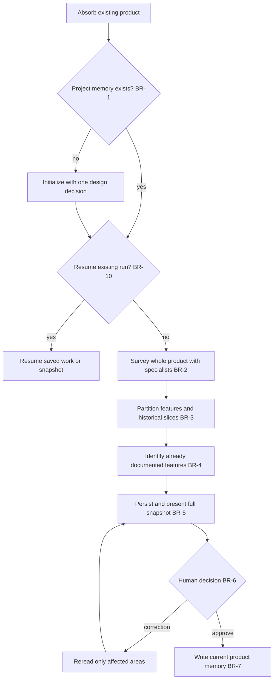
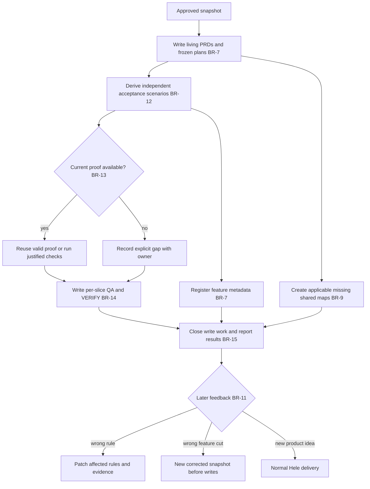

# Existing-Product Absorption

## What

Absorb turns an existing product into durable Hele memory. Specialists inspect the whole product and its history, propose user-recognizable features and chronological increments, and present a complete snapshot before writing feature documents. After the human accepts that snapshot, workers create current-state product descriptions, acceptance scenarios and frozen records of the increments that already exist.

Each absorbed increment also receives a current evidence report and a prepared verification artifact. Existing behavior and proven behavior remain separate: a completed historical plan does not mean every scenario has been validated. Absorb is a separate command from normal product delivery and does not silently start product fixes or a human verification walk.

## Why

The absorb documentation explicitly gives an existing product the same persistent memory that later Hele work can read instead of reconstructing decisions. Recognizable historical slices preserve useful delivery boundaries without making every commit a feature. Current evidence and explicit gaps prevent an inventory of existing behavior from becoming a false claim of passing QA. Other unstated reasons for individual orchestration choices are not recorded.

## Flows

### Read and approve a whole-product snapshot

Initialization is allowed before the snapshot because the workflow needs project settings. Feature documents and shared product maps wait for explicit approval of the proposed cut.

| Branch | Rule |
|---|---|
| Initialize missing settings before reading | BR-1 |
| Resume a saved run rather than duplicate it | BR-10 |
| Survey and partition the complete product | BR-2, BR-3 |
| Preserve existing feature descriptions | BR-4 |
| Approve or correct the complete snapshot | BR-5, BR-6 |
| Begin authorized feature writing | BR-7 |

### Write historical records with honest validation

Approved slices are recorded without build tasks. Proof is assessed separately; missing proof remains a gap and does not trigger product implementation.

| Branch | Rule |
|---|---|
| Create approved current-state memory | BR-7, BR-8 |
| Derive behavior independently | BR-12 |
| Use valid evidence or report missing proof | BR-13 |
| Keep validation separate from historical completion | BR-14 |
| Create only applicable missing shared maps | BR-9 |
| Finish and route later feedback | BR-15, BR-11 |

## Business rules

### BR-1 — Initialize prerequisites before reading the product

Absorb applies to an existing product and begins with the project's Hele memory. If that memory is missing, initialization asks the one-time design-participation question and creates the settings/registry skeleton before any product reading. An existing design answer is not asked again. Beads is mandatory. The required `install --check` command establishes only binary availability; project database usability requires successful database operations and must not be inferred from that check alone. This prerequisite is weaker than a complete readiness check.

### BR-2 — Survey the whole product through named specialists

The initial survey covers implementation/domain behavior, user-facing experience, history and schema. Design is surveyed only when enabled. Findings are read-only and live in the task records rather than extra notes files. Readers return candidate capabilities, implementation and test evidence with paths plus symbols/test names, and observed conflicts. Existing product documents, tests, UI copy/routes and guards/constraints take precedence over names and comments as evidence. The conductor consolidates the reader reports instead of exploring the product itself. Workers are named and dispatched in the background within the configured concurrency limit; the dispatch contract ends that conductor turn and resumes on a later report or message.

### BR-3 — Partition user capabilities into meaningful historical slices

A feature is a capability a person would name, not merely a directory, component kit or deployment configuration. Each product file has one feature owner; other features use pointers rather than duplicate ownership. Two readers with overlapping feature path lists do not run concurrently. Each increment is a recognizable slice that could have shipped independently, numbered oldest first from `001` with an English kebab-case name. Tests and guards establish current rules; history establishes ordering and seams. Several commits can form one slice. When a feature exceeds eight slices, the smallest supporting slices are merged into the capability they serve and that grouping is explained. Motives are stated only when recorded in evidence.

### BR-4 — Preserve already documented capabilities by default

Each proposed feature slug is searched before writing. A matching existing product description appears in the snapshot as already documented and is not rewritten on ordinary snapshot approval. Refreshing that capability requires the human to request it. The reader must not create a second feature solely because aliases or wording differ.

### BR-5 — Present the complete snapshot before feature artifacts exist

The snapshot contains one row per increment, evidence links, an optional already-documented table, and material doubts with recommendations. It is saved in a consolidation task and all read-epic tasks close before presentation. Scratch from the read phase is removed. No feature product description, acceptance scenario document, database map or design-system map is written before approval. The initialization skeleton in BR-1 is the explicit earlier exception; an absolute claim that no file can exist before approval would contradict that prerequisite.

### BR-6 — Approval accepts the cut and its recommendations

Option `1` approves the full feature/increment cut and every stated recommendation. Option `2` or corrective free text writes no feature artifacts. Corrections reread only named capabilities or changed partitions, reusing the prior survey unless its reading was challenged. A challenged survey is reopened only for the affected evidence and dependent features. The next presentation is the complete revised snapshot, not merely a delta. The write phase starts only after approval of that snapshot.

### BR-7 — Write current-state product memory and register it once

After approval, each new feature receives an approved v1.0 product description, independent acceptance scenarios, one historical plan per approved increment and later per-increment validation artifacts. The product description covers all current rules, flows and scope rather than narrating successive implementations. Every business rule is testable; motives without evidence are explicitly not recorded. The initial changelog identifies absorbed slices and their rules. The registry contains the slug, title, summary, English and human-language aliases and product/scenario/plan document versions, without feature status. A refresh patches the existing product description and version rather than registering a duplicate.

### BR-8 — Historical plans are frozen records, never build queues

Each absorbed plan uses the supplied absorb-plan template, has `status: built`, `origin: absorb` and an empty tasks section. It receives no build epic or implementation tasks and is not set ready. Its completed state says that the slice already exists, not that QA is green. Refreshes leave existing absorbed plans frozen and append new slices at the next number. **Known format contradiction:** the template's instruction prohibits XML section tags while its body contains those tags. The approved snapshot preserves that existing template body and records the inconsistency rather than silently changing the product's template.

### BR-9 — Create shared maps only when applicable and missing

A database map is created only if an application schema exists and the map is absent. A design-system map is created only when design is enabled and the map is absent. Existing maps remain intact. Absorb creates no design specification or database-change proposal. A tooling database used for task tracking is not automatically the product's application schema. The hele-skills self-snapshot has no application database and design is disabled, so neither shared map is created here; the harness's shipped design capabilities remain in its feature inventory.

### BR-10 — Resume durable task state instead of starting another survey

Open Absorb tasks resume at ready work. With no open tasks, a completed consolidation whose snapshot has not been written represents the approval/correction stop; its saved snapshot can be shown again after conversation context is lost. Completed write work and files represent the final-report stage. Once that work is closed, a new product idea returns to ordinary Hele delivery. All tasks in an epic close before leaving that epic.

### BR-11 — Apply feedback at the affected level

After writing, a wrong rule patches the living product description with a version/changelog change and refreshes the affected scenarios and increment evidence. It does not rewrite frozen historical plans or resurvey the whole app. A wrong feature cut returns to affected reading and a new full snapshot before further writes. A new product idea belongs to normal delivery, not another automatic absorption.

### BR-12 — Derive acceptance behavior before mapping existing tests

Wylie derives scenario expectations from the approved product description and slice map, without reading the execution plan. Each scenario carries its originating three-digit increment and product-rule reference. Only after deriving behavior does he inspect existing tests to map proof separately. Scenarios start pending until current execution evidence justifies another status. Technical details about an endpoint, table or component do not replace the product-level behavior statement.

### BR-13 — Evaluate proof per slice without duplicating valid executions

Every new increment receives a QA assessment using the shared validation policy's coverage review, execution selection and evidence recording phases. Valid current evidence may be reused across slices; shared journeys are not repeated merely to create a fresh result for each folder. Selected executions depend on behavior and actual existing proof, even when absorption has no production diff. Missing proof remains an explicit gap with an owner, environmental prevention is blocked and an observed failed assertion is failing. Neither source inspection nor an old result makes behavior passing.

### BR-14 — Record the product today without starting remediation or a manual walk

Each increment gets `QA_REPORT.md` and `VERIFY.md` from their templates. Absorb does not run normal QA routing, create build/fix tasks against its frozen plans, start ordinary product delivery or initiate the human walk. Screenshots are optional, follow configured quality/retention rules when useful and show the product as it exists today. There is no before state without an absorbed increment, so no before/after pair is fabricated. Zero new E2E and zero screenshots are valid when the evidence selection justifies them; unresolved proof still remains visible.

### BR-15 — Report completed writing separately from validation success

The index task and every increment's QA task must close before the write epic closes. The final report names written files and counts features, closed historical increments, scenarios, evidence and gaps/blocked items. Incomplete validation remains explicit even though all historical plans say built. Files follow the artifact language and reports follow the chat language. The known strict-model-versus-inheritance contradiction remains a limitation: Claude Code is the shipped distribution, and this Codex run's missing-key inheritance is an adaptation rather than proof of native runtime support.

## Scope

### In scope

- Whole-product evidence gathering, feature ownership and chronological increment cuts.
- Approval and targeted correction of snapshots, current-state feature memory and registry entries.
- Frozen historical plans and honest evidence/gap reports without new implementation work.
- Resume and later correction behavior at the feature, rule or evidence level.

### Out of scope

| Left out | Why |
|---|---|
| New product development and automatic repair of coverage gaps | Absorb records existing behavior; normal delivery owns implementation |
| A manual verification session | The workflow writes its artifact but does not initiate the walk |
| A fabricated application database or design map | Shared maps require the actual applicable product surface |
| A live phase-state file, feature status board or standalone notes files | Durable work evidence is held in task records and product documents |
| Native Codex/Cursor support or resolution of contradictory instructions | This absorption preserves the supported distribution and known limitations |

## Glossary

| Term | Meaning |
|---|---|
| Snapshot | Complete proposed feature/increment inventory presented for approval |
| Absorbed increment | Historical user-visible capability recorded as already existing |
| Frozen plan | A built, origin-absorb record with no executable tasks |
| Current proof | Execution evidence still valid for the relevant code and environment |

## Changelog

- v1.0 (2026-11-18) — absorbed from the app. Slices: 001-snapshot-existing-product (BR-1–BR-11); 002-report-current-validation-and-gaps (BR-12–BR-15).
