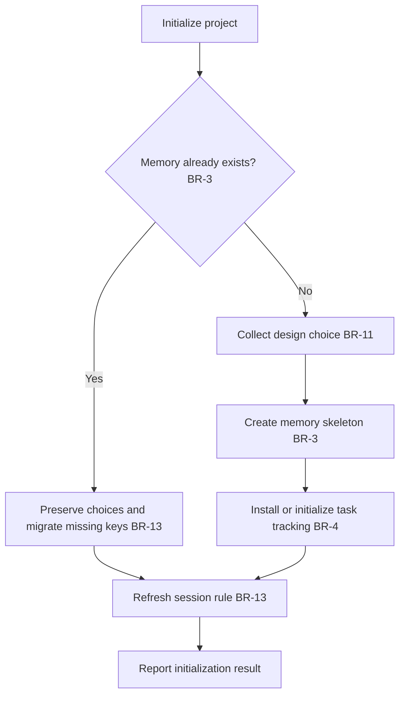
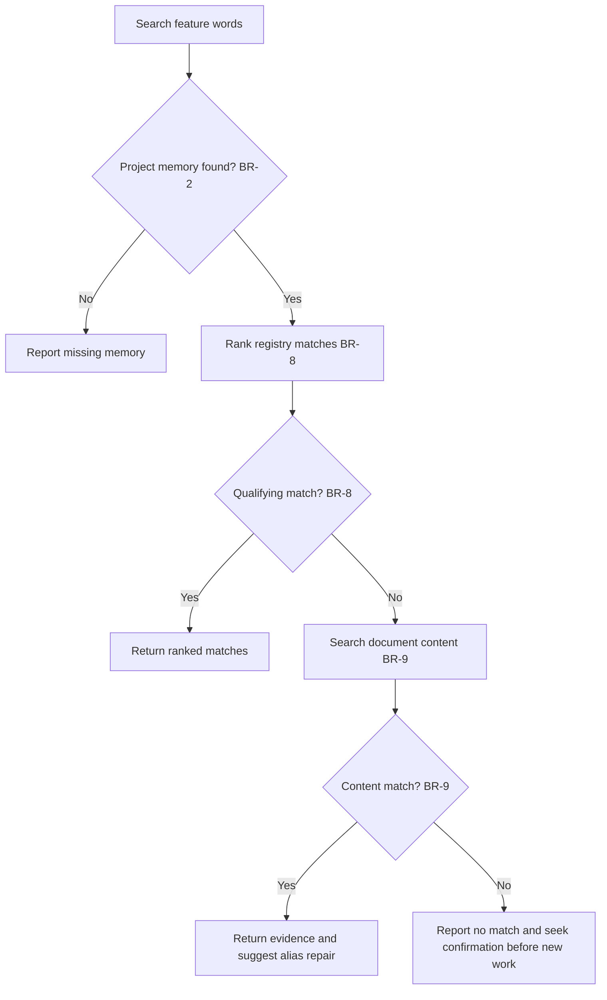
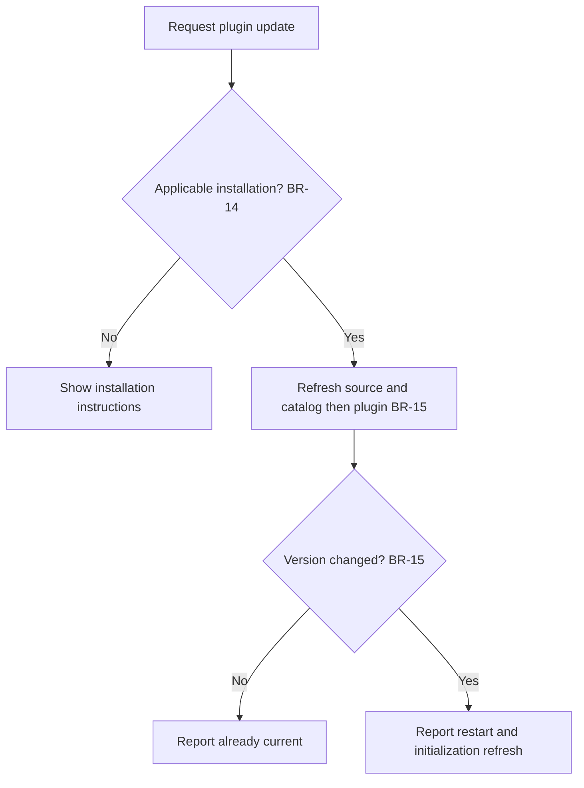
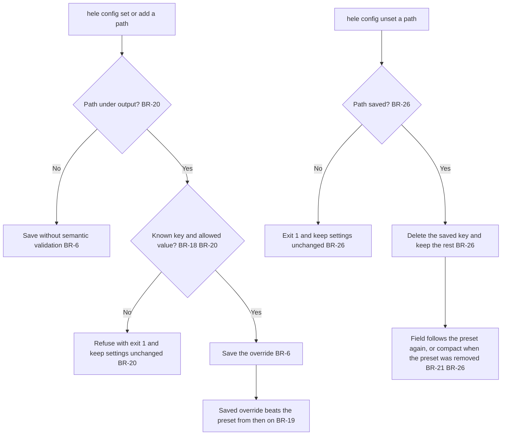
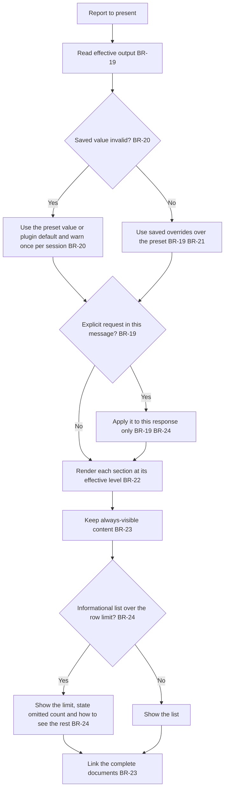

<!-- RULES:
- Written as STATE, not history: it describes how the product works TODAY.
  A superseded rule is REWRITTEN in place, never appended below the old one.
- Patch-only versioning (1.0 → 1.1 → 1.2). A ground-up rebuild is a NEW
  feature folder (<slug>-v2), never a major bump here.
- Every edit bumps the patch version, updates `updated`, adds a changelog line.
- Human-readable markdown ONLY. No XML section tags. A person opens this file
  and understands the product: what, why, flows, rules, scope. Agents find
  sections by the ## / ### headings below.
- Written only after every product question is answered. No Open
  questions section. A question still open means do not create this
  file (new feature) and do not patch it (update). Useful questions
  land in one pack before this file exists (accept all / one by one /
  open reply). A recommendation belongs in that pack, not in a rule
  written ahead of the answer.
- Business rules are numbered (BR-n) and testable — TEST_STUBS reference them.
  Each rule is a ### BR-n — Title heading with enough prose to review alone.
- Each named flow: ### caption, then a short prose paragraph, then the mermaid,
  then a Branch | Rule table listing every BR-n that governs a branch in THAT
  diagram (not a dump of all rules). Keep BR-n on mermaid edges/nodes too.
- Written in English, like every artifact.
-->
---
feature: project-memory
doc: PRODUCT_DESCRIPTION
version: "1.1"
status: approved
updated: 2026-11-25
---

# Project Memory and Setup

## What

Hele gives a project persistent settings and a searchable registry of product features. A person installs the Claude Code plugin, initializes the project once, changes saved preferences, discovers existing feature memory, and updates the installed plugin without creating a product increment.

Settings also decide how much of each report appears in the conversation. A preset (`compact`, `standard` or `detailed`) and optional per-section overrides control chat presentation only: documents, evidence, tests, approval criteria and workflow stages stay complete, and failures, blockers, missing coverage, questions and decisions stay visible under every setting. One resolution supplies the effective presentation to every skill and agent, and the human can expand any summarized detail on request without repeating work.

The terminal companion provides `install`, `config`, `find`, and `ai`. Initialization and plugin maintenance are agent workflows; terminal search and configuration are executable CLI behavior. Source instructions alone do not establish that an agent completed a workflow successfully.

## Why

Persistent product documents let later sessions read existing decisions instead of guessing. Search supports finding existing capabilities before creating duplicates. Project settings retain team, design and language choices across sessions. Configurable chat output exists because full scenario tables, coverage recommendations, QA results, file tables and dispatch tables in every delivery make it hard to find the outcome and the next decision, especially as a feature accumulates scenarios; often it is enough to know scenarios were defined and open the document when needed (GitHub issue #34). These purposes are stated in the introduction, CLI documentation, skill descriptions and that issue. The rationale for individual ranking weights and low-level serialization choices is not recorded.

## Flows

### Initialize or refresh a project

A new project receives a memory skeleton after its design choice. Reinitializing preserves existing choices and product documents while performing the specific migrations and session-rule refresh described below.

| Branch | Rule |
|---|---|
| First initialization creates only the skeleton | BR-3 |
| First initialization collects design participation | BR-11 |
| Mandatory task tracking reports failure explicitly | BR-4 |
| Existing choices survive permitted migrations and session-rule replacement | BR-13 |

### Find existing memory

Search ranks registry matches first. Only when none qualifies does it search document contents; a content-only match signals incomplete registry aliases rather than authorization to create another feature.

| Branch | Rule |
|---|---|
| Required project memory cannot be resolved | BR-2 |
| Registry score meets or misses the threshold | BR-8 |
| Document fallback finds evidence or reports no match | BR-9 |

### Update an installed plugin

The current project's installation takes precedence over a user installation. A changed version requires restarting the runtime before new skills load.

| Branch | Rule |
|---|---|
| Select project installation, then user installation, or stop | BR-14 |
| Refresh in order and report changed versus unchanged versions | BR-15 |

### Save an output preference

A change under `output` is checked before it is written. An invalid value is refused and leaves the saved settings unchanged; every other settings key keeps the unvalidated behavior of BR-6. Removing a saved value with `unset` hands that field back to the preset, or to the plugin default when the preset itself is removed.

| Branch | Rule |
|---|---|
| Keys outside `output` keep the unvalidated write behavior | BR-6 |
| Allowed keys and values under `output` | BR-18 |
| An invalid `output` value is refused with exit 1 | BR-20 |
| A saved override takes precedence over the preset | BR-19 |
| Unset removes a saved key or exits 1 when the path is not saved | BR-26 |
| A removed output field follows the preset again; a removed preset means `compact` | BR-21, BR-26 |

### Present a report under the effective output

Every report starts from the same effective configuration. The current message can ask for more or less for that response only; always-visible content and the full documents survive every setting.

| Branch | Rule |
|---|---|
| One central resolution supplies the effective output | BR-19 |
| Invalid hand-edited values fall back with one warning per session | BR-20 |
| Preset values and saved overrides | BR-21, BR-19 |
| A one-off request changes this response only, never saved settings | BR-19, BR-24 |
| Section levels decide how much of each block appears | BR-22 |
| Failures, gaps, blockers, questions, decisions, options and walk steps always appear | BR-23 |
| A limited list states what was omitted and how to see it | BR-24 |

## Business rules

### BR-1 — Install the shipped plugin and terminal companion

The plugin identity is `hele-skills@hele`, from marketplace `hele`. The marketplace may come from GitHub or the contributor's local clone. The shipped adapter is Claude Code. The bundled terminal companion is callable through `scripts/hele` without installing runtime npm dependencies. Retained Cursor references or model entries do not constitute a shipped Cursor adapter; this snapshot's Codex execution is an adaptation, not native Codex support. Plugin release and CLI version are separate displayed values.

Evidence: [README.md](../../../README.md) installation and contributor instructions; [plugin.json](../../../.claude-plugin/plugin.json); [index.js](../../../cli/src/index.js) command registration; [hele](../../../scripts/hele).

### BR-2 — Resolve one project memory directory

When `HELE_DIR` is set, use that directory only if it exists and is a directory. An invalid explicit override does not fall back to ancestor discovery. Otherwise find the nearest `.hele/` while walking upward from the current directory. `.helerc` does not change the folder name. Commands that require memory report its absence and exit with code 2.

Evidence: [dir.js](../../../cli/src/dir.js), `resolveHeleDir` and `requireHeleDir`.

### BR-3 — Initialize only the project memory skeleton

For a new project, initialization creates settings from the defaults with the human's design choice, an empty feature registry, and a feature directory with its placeholder. It creates no feature PRD. The project is expected to be a Git repository; when it is not, the workflow reports that fact and does not initialize Git without asking. Existing memory follows the migration/preservation rule in BR-13 instead of being reset.

Evidence: [SKILL.md](../../../skills/hele-init/SKILL.md), phases `0-detect` and `2-create`.

### BR-4 — Make task-tracking readiness explicit

Task tracking is mandatory. The installer uses an existing `bd` binary or installs it through available Homebrew or the official installer, then initializes the project database without replacing agent guidance. Installation or initialization failure is reported as a blocker. `install --check` verifies binary availability only: it neither initializes nor proves project-database readiness. Successful database operations are separate readiness evidence.

Evidence: [install.js](../../../cli/src/install.js), `installCommand`, `installBdBinary` and `initBeadsProject`; [SKILL.md](../../../skills/hele-init/SKILL.md), phase `2-create`.

### BR-5 — Read saved settings without an implicit CLI defaults merge

Configuration list/get returns the saved settings. A missing settings document exits with code 2; a requested missing value exits with code 1. List and get never merge defaults, including for `output`: `hele config get output.preset` in a project that never saved one reports a missing value, not `compact`. The only read that applies defaults is the separate effective-output resolution (BR-19), which leaves list/get unchanged. Defaults used by initialization or an agent's fallback are separate mechanisms. Documentation that broadly promises defaults for absent keys therefore overstates standalone CLI `get` behavior.

Evidence: [config.js](../../../cli/src/config.js), `loadSettings` and `configCommand`; conflicting prose in [configuration.md](../../../.docs/configuration.md) and [cli.md](../../../.docs/cli.md).

### BR-6 — Persist configuration edits and deduplicated list additions

A set/add value is parsed as JSON when possible and otherwise saved as text. Set creates missing intermediate objects and replaces the selected value; traversal through a scalar, null or array is rejected. Add initializes a missing or null list, rejects other non-list values, and avoids duplicates using serialized-value equality. Writes preserve the remaining settings and serialize the full document with a trailing newline. Outside `output`, the CLI does not validate supported preference names, semantic ranges or model names. Paths under `output` are the explicit exception: they are validated before writing and an invalid value is refused (BR-20). Missing required arguments or an unsupported action exits with code 2; rejected traversal or list operations exits with code 1. Removing a saved value is a separate action, `unset` (BR-26).

Evidence: [config.js](../../../cli/src/config.js), `parseValue` and `configCommand`.

### BR-7 — List registered features without a feature-status board

A missing registry behaves as an empty feature list; invalid JSON is reported with exit code 2. Listing returns registered features, their PRD versions and summaries, or a machine-readable registry. The authoring contract uses slugs, titles, summaries, aliases and document versions, without a feature progress status. The reader tolerates arbitrary existing entry fields, including legacy status; that tolerance does not create a current status-board capability. No uniqueness or referential-integrity enforcement is supplied by the reader.

Evidence: [find.js](../../../cli/src/find.js), `loadIndex` and `findCommand`; [SKILL.md](../../../skills/hele-init/SKILL.md), index migration.

### BR-8 — Rank matching registry entries consistently

Registry matching folds case, separators and diacritics. Each feature receives its best qualifying score, and results sort by score descending. The threshold is 40.

| Match | Score |
|---|---|
| Exact slug | 100 |
| Exact alias | 95 |
| Slug/title substring | 80 |
| Alias substring | 78 |
| Approximate bigram similarity | Up to 75 |
| Summary keyword overlap | Up to 55 |

Search may return multiple features and supports machine-readable results. It does not itself create or approve a new feature.

Evidence: [find.js](../../../cli/src/find.js), `norm`, `fuzzy`, `scoreFeature` and `findCommand`.

### BR-9 — Use document fallback only after registry matching fails

When no registry match reaches the threshold, search Markdown under the feature directory using normalized query tokens longer than two characters. Group matches by feature folder and suggest repairing registry aliases when only content matches. File text is lowercased but is not diacritic-folded, so the registry's accent-insensitivity guarantee does not extend to document fallback. When neither source matches, report no match and advise confirmation before treating work as a new feature. Search without terms or a list request exits with code 2.

Evidence: [find.js](../../../cli/src/find.js), `contentFallback` and `findCommand`.

### BR-10 — Provide workflow help without initialized memory

`hele ai` works without `.hele/`. Its overview uses the canonical flow diagram shared with the README. Named skill help accepts the supported short names and `hele-` or `/hele-` prefixes. An unknown name exits with code 1 and lists supported choices. The help catalog is incomplete relative to source skills: it does not currently include `absorb` or `paper-to-code`. Help is explanation, not a workflow execution engine.

Evidence: [ai.js](../../../cli/src/ai.js), `SKILLS` and `aiCommand`; [flow-diagram.js](../../../cli/src/flow-diagram.js), `FLOW_DIAGRAM`; [README.md](../../../README.md), The flow.

### BR-11 — Ask for design participation once

First initialization offers three choices: an existing design system with supplied paths, future design work without an existing system, or no design work. The first two enable design; the last disables it. An existing design answer is preserved and is not asked again. Choosing no design for this repository does not remove the harness's design capabilities for consumer projects.

Evidence: [SKILL.md](../../../skills/hele-init/SKILL.md), phase `1-interview`; [default-config.json](../../../core/default-config.json), `designSystem`.

### BR-12 — Retain named-team preferences without claiming unsupported dispatch

Settings retain the maximum concurrent workers (default 4) and named-role model preferences. A plain model value applies across runtimes; defaults contain Claude Code and Cursor mappings. The configuration/reporting contract permits missing-runtime or `inherit` fallback, while stricter dispatch wording elsewhere conflicts with that fallback. This is a recorded contract limitation, not a verified guarantee of dispatch on unsupported runtimes. There is no default Codex model mapping and no shipped Codex adapter.

Evidence: [default-config.json](../../../core/default-config.json), `agents`; [configuration.md](../../../.docs/configuration.md), agents/models; approved snapshot conflict recorded from the shared dispatch survey.

### BR-13 — Preserve choices while applying explicit initialization migrations

Reinitialization fills missing index/features and missing settings keys while preserving existing values and PRDs. It renames `dba-red-john` to `dba-hightower` only when the latter is absent, removes `pm-hightower`, and removes legacy status fields from feature registry entries while retaining their other metadata. It always replaces `.claude/rules/hele-session.md` with the current concatenated session templates. It creates no `.cursor/` directory. The blanket documentation statement that init never overwrites a file has these explicit exceptions.

Evidence: [SKILL.md](../../../skills/hele-init/SKILL.md), phase `2-create` and rules; conflicting introduction in [getting-started.md](../../../.docs/getting-started.md).

### BR-14 — Choose the applicable plugin installation before updating

Inspect installed `hele-skills@hele` entries. Prefer the installation for the current project; otherwise use a user-scope installation. When neither exists, stop and provide installation instructions. Use the existing marketplace identity and discovered scope rather than inventing another installation target.

Evidence: [SKILL.md](../../../skills/hele-update/SKILL.md), steps 1–2.

### BR-15 — Update in order and report restart requirements

For a local-folder marketplace, first pull its source. Refresh marketplace `hele` before updating `hele-skills@hele` at the chosen scope. Do not pass `-y`; if the CLI requests confirmation, show the command and return control to the human. Report versions before/after and scope. An unchanged version is already current. A changed version requires a runtime restart, followed by one init refresh when memory exists to update session rules and model keys. Updating does not create a PRD or commit product work.

Evidence: [SKILL.md](../../../skills/hele-update/SKILL.md), steps 2–6.

### BR-16 — Separate conversation and artifact language preferences

The default chat language is `auto`, following the human's language in the session; an explicit language tag may override it. Artifacts default to English, with `en` and `en-US` equivalent. Chat preference applies to report labels and prose while filenames, commands, identifiers and formal agent tags stay unchanged. It does not localize the CLI's English output. Reinitialization fills missing keys without replacing existing choices.

Evidence: [default-config.json](../../../core/default-config.json), `language`; [configuration.md](../../../.docs/configuration.md); [language.test.js](../../../cli/test/language.test.js).

### BR-17 — Store an evidence-image ceiling rather than a quota

The default maximum retained QA screenshots is 10. It is a configurable ceiling for useful optional evidence, not a required count. The CLI stores the preference but does not validate its numeric range. Capture selection and proof requirements belong to behavior validation; a saved limit does not prove a screenshot was taken or a test passed.

Evidence: [default-config.json](../../../core/default-config.json), `qa`; [configuration.md](../../../.docs/configuration.md), QA settings.

### BR-18 — Output settings control chat presentation only

The `output` settings section holds a preset, two global controls and six section values. Every key is optional; a project can save only a preset, only the overrides it needs, or nothing.

| Key | Allowed values |
|---|---|
| `output.preset` | `compact`, `standard`, `detailed` |
| `output.tables` | `auto`, `always` |
| `output.maxTableRows` | positive integer |
| `output.sections.testStubs` | `off`, `summary`, `full` |
| `output.sections.coverage` | `off`, `summary`, `full` |
| `output.sections.prdDelta` | `summary`, `full` |
| `output.sections.qaResults` | `summary`, `issues`, `full` |
| `output.sections.dispatch` | `brief`, `full` |
| `output.sections.screenshots` | `off`, `links`, `inline` |

These settings change only what appears in the conversation. They never change what a document contains, which evidence is collected, which tests run, approval criteria, workflow stages or work state. Chat text keeps following `language.chat` and documents keep following `language.artifacts` (BR-16) under every output setting.

### BR-19 — Resolve the effective output in one place and in a fixed order

For each field the effective value is, from strongest to weakest: an explicit request in the current message, the saved section or global override, the value the saved preset gives that field (BR-21), and the plugin default, which is the `compact` preset. An explicit request in the message applies to that response only and never changes saved settings unless the human asks to save it, which goes through `hele config set`. Such a request changes only the level of detail: it cannot suppress always-visible content (BR-23), which still appears even when the human asks to hide it. A saved override wins under any preset, including a saved `maxTableRows`.

`hele config effective output` prints the effective output configuration as JSON that mirrors the saved layout: `preset`, `tables`, `maxTableRows` and `sections` with all six section fields (`testStubs`, `coverage`, `prdDelta`, `qaResults`, `dispatch`, `screenshots`), every field resolved from plugin defaults, the preset and the saved overrides, plus a `warnings` array naming each invalid saved value and the value used instead (BR-20), empty when there are none. It writes nothing. Without project memory or without a settings document it prints the plugin defaults, so standalone workflows such as the E2E audit read the same resolution. Every skill and agent takes its presentation from this one resolution instead of carrying its own defaults. Configuration list/get stay saved-values-only (BR-5).

### BR-20 — Refuse invalid output values on write; fall back on read

`hele config set` or `hele config add` on a path under `output` exits with code 1 and leaves the settings file unchanged when the key is not one listed in BR-18, the value is not an allowed enum value, or `maxTableRows` is not a positive integer (zero, a negative number, a fraction or text). Setting a whole object under `output` is accepted only when every key and value inside it is valid. A value at `output` or `output.sections` that is not an object (a number, text, null or a list) is refused the same way. An empty object `{}` is valid there and means nothing is saved at that level. No `output` setting is a list, so `add` under `output` is refused. This is an explicit exception to BR-6, which stays true for every other key.

A settings file edited by hand can still hold an invalid `output` value. The resolution then uses, for that field, the value the active preset gives it; when the preset itself is invalid, the plugin default (`compact`) supplies every field the saved overrides do not. An unknown key under `output` is ignored. A non-object value at `output` or `output.sections` is treated as absent: at `output.sections` the preset supplies every section, and at `output` the plugin default (`compact`) supplies every field. Each case produces one short warning naming the key and the value used instead. The warning is shown once per session, not repeated in every report.

### BR-21 — Presets set every section, the table mode and the row limit

| Field | `compact` (default) | `standard` | `detailed` |
|---|---|---|---|
| testStubs | summary | summary | full |
| coverage | summary | summary | full |
| prdDelta | summary | full | full |
| qaResults | issues | issues | full |
| dispatch | brief | brief | full |
| screenshots | links | links | inline |
| tables | auto | auto | always |
| maxTableRows | 8 | 15 | 30 |

`compact` shows a short outcome, the relevant counts, issues and decisions, and document links. `standard` adds the full product-rule delta. `detailed` restores presentation close to the earlier full-table reports without configuring each section; its long lists still respect the row limit and can be expanded. A saved override of any field replaces only that field; removing it with `hele config unset` makes that field follow the preset again (BR-26).

### BR-22 — Section values decide how much of each block appears

| Section | Value | What the conversation shows |
|---|---|---|
| testStubs | off | No scenario block; the scenarios document stays linked in the delivery |
| testStubs | summary | The feature's total number of scenarios, this delivery's new, revised and retired counts, and the scenarios document link |
| testStubs | full | The scenario table |
| coverage | off | No coverage block; the coverage recommendations stay linked in their document |
| coverage | summary | Counts by test level and owner, and every missing required coverage item |
| coverage | full | The coverage recommendation table |
| prdDelta | summary | Each new, rewritten or retired rule by id and title with the behavior change in one sentence, enough for an informed approval |
| prdDelta | full | The summary plus the previous and new wording of each changed rule |
| qaResults | summary | Overall result and counts, with each failure, gap, blocker and pending decision named in one line |
| qaResults | issues | Passes as counts; failures, coverage gaps, blockers and pending decisions in detail |
| qaResults | full | Every result, passing ones included |
| dispatch | brief | One line per dispatch naming the agent, the work and the fields the execution contract needs in compact form, the model among them |
| dispatch | full | The dispatch table |
| screenshots | off | No captures in chat |
| screenshots | links | A link to each capture shown |
| screenshots | inline | The capture embedded in the message |

`tables: auto` allows prose or a short list for small amounts of information instead of one-row tables; `always` presents structured information as tables. Neither permits box-drawing frames. The `screenshots` value is presentation only and independent of `qa.maxScreenshots` (BR-17): it never changes which captures are taken or retained. For the E2E audit, the conversation shows the diagnosis and the leading recommendations within the row limit, while the full inventory and rationale stay in the audit report.

### BR-23 — Some content is visible under every setting

Under every preset and every section value, `off` included, and whatever the current message asks (BR-19), the conversation still shows at least a summary of: failures, blockers, missing required coverage, product questions, required decisions, workflow options and approvals, and the steps of a human verification walk. Failures, blockers and missing required coverage are never cut by `maxTableRows`, whatever their count: each item gets at least one line with its id and its cause, and only the detail shown per item follows the section level. Options and approvals may be presented compactly but keep their meaning and every choice. A verification walk keeps all its actions. An omitted test detail is not missing evidence: the complete artifact stays inspectable and linked from the report that omitted it.

### BR-24 — Limited lists say so, and expansion only re-presents

`maxTableRows` limits informational lists, including those shown at a `full` level. Failures, blockers and missing required coverage are not informational lists and are never limited (BR-23). A limited list states how many items were omitted and how to see them (the document link or the request that expands it); it never implies it is complete. The row limit never silently drops a question that needs an answer or an item the human must approve: such content is grouped or explicitly paginated instead.

A request such as "show all TS", "expand TS-014" or "show the full QA report" re-presents information that already exists, lifting the limit or section level for that response. It does not restart a phase, rerun tests, change approvals, change work state or change saved settings.

### BR-25 — Existing projects move to the compact default without losing saved choices

A project without an `output` section presents as `compact`. This is a documented change of default from the earlier full-table presentation; `hele config set output.preset detailed` brings back presentation close to it. Initialization writes `output.preset` as `compact` for a new project. Reinitialization, consistent with BR-13, adds `output.preset` only when it is missing and never replaces a saved `output` value. Neither ever writes section values, `tables` or `maxTableRows`, because a saved field would override every later preset choice (BR-19). A field saved earlier can be removed with `hele config unset` to return it to the preset (BR-26).

### BR-26 — Remove a saved setting with unset

`hele config unset <path>` deletes the saved key at that dot path, for any settings path, and writes the rest of the settings document unchanged with the same serialization as BR-6. When the path does not exist in the saved settings, including a path that traverses a scalar, null or array, it exits with code 1 and writes nothing. A missing path argument exits with code 2, as for the other actions (BR-6); a missing settings document exits with code 2 (BR-5). Unset applies no value validation, so it can also remove an invalid or unknown key under `output` left by a hand edit (BR-20).

For `output`, removing a saved section value, `tables` or `maxTableRows` makes that field follow the preset again (BR-21). Removing `output.preset` makes the plugin default, `compact`, the preset; removing the whole `output` section returns every field to `compact`. Unset changes only saved settings; it never changes documents, work state or approvals.

## Scope

### In scope

- Claude Code installation/update and project memory initialization.
- Saved settings, design/team/language preferences and explicit migrations.
- Registry lookup, document fallback and terminal workflow guidance.
- Known differences between source promises, CLI behavior and unsupported runtime adaptations.
- Chat output presets, per-section overrides, their validation, fallback and central resolution, always-visible content, limited lists and on-demand expansion.
- Removing a saved setting with `unset`.

### Out of scope

| Left out | Why |
|---|---|
| Feature delivery, approval and construction | Owned by guided-delivery |
| Consumer design implementation | Owned by visual-design |
| Test execution, evidence judgment and human walks | Owned by behavior-validation |
| Product absorption and suite audits | Separate features |
| Application database or schema migrations | This product stores JSON/Markdown; Beads owns its external task storage |
| Shipped Cursor/Codex adapters and complete CLI localization | Not present in the current distribution |
| Claims of validated agent behavior | Source inspection establishes contracts; QA records actual proof separately |
| Output settings that change document contents, evidence, tests, approvals or workflow stages | `output` is chat presentation only (BR-18) |
| A separate switch for every visual detail | Controls start with the largest sources of noise and grow from actual use |

## Glossary

| Term | Meaning |
|---|---|
| Project memory | Settings, registry and feature documents under `.hele/` |
| Registry | Search metadata and document versions, not a feature progress board |
| Scope | The installed plugin's project or user installation boundary |
| Output preset | A named bundle (`compact`, `standard`, `detailed`) that sets every output section, the table mode and the row limit |
| Section override | A saved value for one output field that wins over the preset |
| Effective output | The presentation resolved from the current request, saved overrides, preset and plugin default |
| Informational list | A list shown for reference that the row limit may shorten; failures, blockers, missing required coverage, questions and items needing approval are never informational lists |
| Always-visible content | Failures, blockers, missing required coverage, questions, decisions, options, approvals and verification steps; shown under every setting and every one-off request. Failures, blockers and missing required coverage are outside the row limit, one line per item with its id and cause |

## Changelog

- v1.0 (2026-11-18) — absorbed from the app. Slices: 001-initialize-project-memory (BR-1–BR-6); 002-find-memory-and-workflow-guidance (BR-7–BR-10); 003-customize-team-and-session-behavior (BR-11–BR-13); 004-update-installed-plugin (BR-14, BR-15); 005-configure-report-language-and-evidence-limits (BR-16, BR-17).
- v1.1 (2026-11-25) — configurable chat output (GitHub issue #34). Slice: 007-configure-chat-output (new BR-18–BR-26, BR-26 adding `hele config unset`; always-visible items outside the row limit and not suppressible by a one-off request, non-object `output` values, `testStubs` summary counts and the effective-output JSON shape; rewritten BR-5, BR-6; new flows Save an output preference and Present a report under the effective output).
