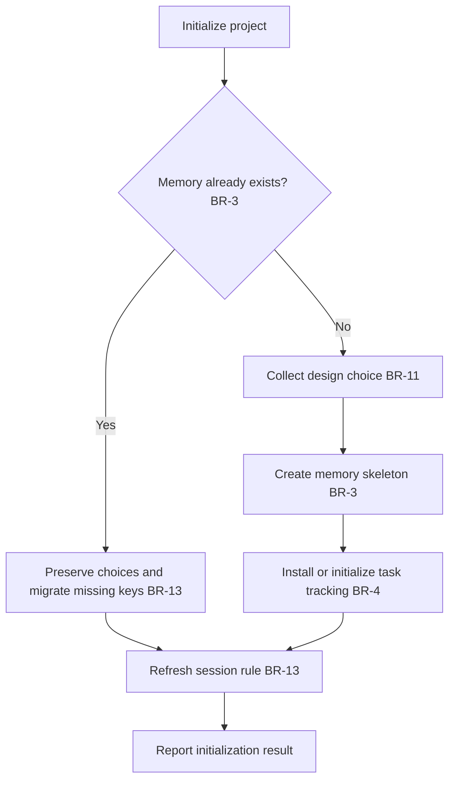
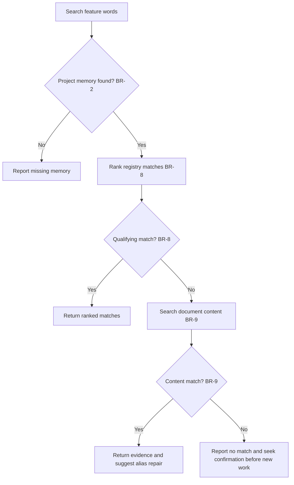
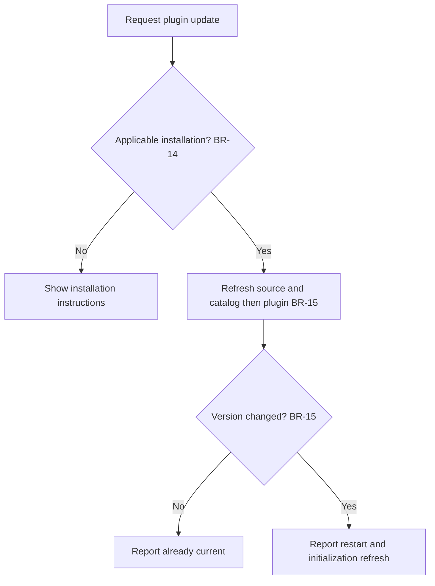

<!-- RULES:
- Written as STATE, not history: it describes how the product works TODAY.
  A superseded rule is REWRITTEN in place, never appended below the old one.
- Patch-only versioning (1.0 → 1.1 → 1.2). A ground-up rebuild is a NEW
  feature folder (<slug>-v2), never a major bump here.
- Every edit bumps the patch version, updates `updated`, adds a changelog line.
- Human-readable markdown ONLY. No XML section tags. A person opens this file
  and understands the product: what, why, flows, rules, scope. Agents find
  sections by the ## / ### headings below.
- Written only after every product question is answered. No Open
  questions section. A question still open means do not create this
  file (new feature) and do not patch it (update). Useful questions
  land in one pack before this file exists (accept all / one by one /
  open reply). A recommendation belongs in that pack, not in a rule
  written ahead of the answer.
- Business rules are numbered (BR-n) and testable — TEST_STUBS reference them.
  Each rule is a ### BR-n — Title heading with enough prose to review alone.
- Each named flow: ### caption, then a short prose paragraph, then the mermaid,
  then a Branch | Rule table listing every BR-n that governs a branch in THAT
  diagram (not a dump of all rules). Keep BR-n on mermaid edges/nodes too.
- Written in English, like every artifact.
-->
---
feature: project-memory
doc: PRODUCT_DESCRIPTION
version: "1.0"
status: approved
updated: 2026-11-18
---

# Project Memory and Setup

## What

Hele gives a project persistent settings and a searchable registry of product features. A person installs the Claude Code plugin, initializes the project once, changes saved preferences, discovers existing feature memory, and updates the installed plugin without creating a product increment.

The terminal companion provides `install`, `config`, `find`, and `ai`. Initialization and plugin maintenance are agent workflows; terminal search and configuration are executable CLI behavior. Source instructions alone do not establish that an agent completed a workflow successfully.

## Why

Persistent product documents let later sessions read existing decisions instead of guessing. Search supports finding existing capabilities before creating duplicates. Project settings retain team, design and language choices across sessions. These purposes are stated in the introduction, CLI documentation and skill descriptions. The rationale for individual ranking weights and low-level serialization choices is not recorded.

## Flows

### Initialize or refresh a project

A new project receives a memory skeleton after its design choice. Reinitializing preserves existing choices and product documents while performing the specific migrations and session-rule refresh described below.

| Branch | Rule |
|---|---|
| First initialization creates only the skeleton | BR-3 |
| First initialization collects design participation | BR-11 |
| Mandatory task tracking reports failure explicitly | BR-4 |
| Existing choices survive permitted migrations and session-rule replacement | BR-13 |

### Find existing memory

Search ranks registry matches first. Only when none qualifies does it search document contents; a content-only match signals incomplete registry aliases rather than authorization to create another feature.

| Branch | Rule |
|---|---|
| Required project memory cannot be resolved | BR-2 |
| Registry score meets or misses the threshold | BR-8 |
| Document fallback finds evidence or reports no match | BR-9 |

### Update an installed plugin

The current project's installation takes precedence over a user installation. A changed version requires restarting the runtime before new skills load.

| Branch | Rule |
|---|---|
| Select project installation, then user installation, or stop | BR-14 |
| Refresh in order and report changed versus unchanged versions | BR-15 |

## Business rules

### BR-1 — Install the shipped plugin and terminal companion

The plugin identity is `hele-skills@hele`, from marketplace `hele`. The marketplace may come from GitHub or the contributor's local clone. The shipped adapter is Claude Code. The bundled terminal companion is callable through `scripts/hele` without installing runtime npm dependencies. Retained Cursor references or model entries do not constitute a shipped Cursor adapter; this snapshot's Codex execution is an adaptation, not native Codex support. Plugin release and CLI version are separate displayed values.

Evidence: [README.md](../../../README.md) installation and contributor instructions; [plugin.json](../../../.claude-plugin/plugin.json); [index.js](../../../cli/src/index.js) command registration; [hele](../../../scripts/hele).

### BR-2 — Resolve one project memory directory

When `HELE_DIR` is set, use that directory only if it exists and is a directory. An invalid explicit override does not fall back to ancestor discovery. Otherwise find the nearest `.hele/` while walking upward from the current directory. `.helerc` does not change the folder name. Commands that require memory report its absence and exit with code 2.

Evidence: [dir.js](../../../cli/src/dir.js), `resolveHeleDir` and `requireHeleDir`.

### BR-3 — Initialize only the project memory skeleton

For a new project, initialization creates settings from the defaults with the human's design choice, an empty feature registry, and a feature directory with its placeholder. It creates no feature PRD. The project is expected to be a Git repository; when it is not, the workflow reports that fact and does not initialize Git without asking. Existing memory follows the migration/preservation rule in BR-13 instead of being reset.

Evidence: [SKILL.md](../../../skills/hele-init/SKILL.md), phases `0-detect` and `2-create`.

### BR-4 — Make task-tracking readiness explicit

Task tracking is mandatory. The installer uses an existing `bd` binary or installs it through available Homebrew or the official installer, then initializes the project database without replacing agent guidance. Installation or initialization failure is reported as a blocker. `install --check` verifies binary availability only: it neither initializes nor proves project-database readiness. Successful database operations are separate readiness evidence.

Evidence: [install.js](../../../cli/src/install.js), `installCommand`, `installBdBinary` and `initBeadsProject`; [SKILL.md](../../../skills/hele-init/SKILL.md), phase `2-create`.

### BR-5 — Read saved settings without an implicit CLI defaults merge

Configuration list/get returns the saved settings. A missing settings document exits with code 2; a requested missing value exits with code 1. The CLI does not merge defaults during reads. Defaults used by initialization or an agent's fallback are separate mechanisms. Documentation that broadly promises defaults for absent keys therefore overstates standalone CLI `get` behavior.

Evidence: [config.js](../../../cli/src/config.js), `loadSettings` and `configCommand`; conflicting prose in [configuration.md](../../../.docs/configuration.md) and [cli.md](../../../.docs/cli.md).

### BR-6 — Persist configuration edits and deduplicated list additions

A set/add value is parsed as JSON when possible and otherwise saved as text. Set creates missing intermediate objects and replaces the selected value; traversal through a scalar, null or array is rejected. Add initializes a missing or null list, rejects other non-list values, and avoids duplicates using serialized-value equality. Writes preserve the remaining settings and serialize the full document with a trailing newline. The CLI does not validate supported preference names, semantic ranges or model names. Missing required arguments or an unsupported action exits with code 2; rejected traversal or list operations exits with code 1.

Evidence: [config.js](../../../cli/src/config.js), `parseValue` and `configCommand`.

### BR-7 — List registered features without a feature-status board

A missing registry behaves as an empty feature list; invalid JSON is reported with exit code 2. Listing returns registered features, their PRD versions and summaries, or a machine-readable registry. The authoring contract uses slugs, titles, summaries, aliases and document versions, without a feature progress status. The reader tolerates arbitrary existing entry fields, including legacy status; that tolerance does not create a current status-board capability. No uniqueness or referential-integrity enforcement is supplied by the reader.

Evidence: [find.js](../../../cli/src/find.js), `loadIndex` and `findCommand`; [SKILL.md](../../../skills/hele-init/SKILL.md), index migration.

### BR-8 — Rank matching registry entries consistently

Registry matching folds case, separators and diacritics. Each feature receives its best qualifying score, and results sort by score descending. The threshold is 40.

| Match | Score |
|---|---|
| Exact slug | 100 |
| Exact alias | 95 |
| Slug/title substring | 80 |
| Alias substring | 78 |
| Approximate bigram similarity | Up to 75 |
| Summary keyword overlap | Up to 55 |

Search may return multiple features and supports machine-readable results. It does not itself create or approve a new feature.

Evidence: [find.js](../../../cli/src/find.js), `norm`, `fuzzy`, `scoreFeature` and `findCommand`.

### BR-9 — Use document fallback only after registry matching fails

When no registry match reaches the threshold, search Markdown under the feature directory using normalized query tokens longer than two characters. Group matches by feature folder and suggest repairing registry aliases when only content matches. File text is lowercased but is not diacritic-folded, so the registry's accent-insensitivity guarantee does not extend to document fallback. When neither source matches, report no match and advise confirmation before treating work as a new feature. Search without terms or a list request exits with code 2.

Evidence: [find.js](../../../cli/src/find.js), `contentFallback` and `findCommand`.

### BR-10 — Provide workflow help without initialized memory

`hele ai` works without `.hele/`. Its overview uses the canonical flow diagram shared with the README. Named skill help accepts the supported short names and `hele-` or `/hele-` prefixes. An unknown name exits with code 1 and lists supported choices. The help catalog is incomplete relative to source skills: it does not currently include `absorb` or `paper-to-code`. Help is explanation, not a workflow execution engine.

Evidence: [ai.js](../../../cli/src/ai.js), `SKILLS` and `aiCommand`; [flow-diagram.js](../../../cli/src/flow-diagram.js), `FLOW_DIAGRAM`; [README.md](../../../README.md), The flow.

### BR-11 — Ask for design participation once

First initialization offers three choices: an existing design system with supplied paths, future design work without an existing system, or no design work. The first two enable design; the last disables it. An existing design answer is preserved and is not asked again. Choosing no design for this repository does not remove the harness's design capabilities for consumer projects.

Evidence: [SKILL.md](../../../skills/hele-init/SKILL.md), phase `1-interview`; [default-config.json](../../../core/default-config.json), `designSystem`.

### BR-12 — Retain named-team preferences without claiming unsupported dispatch

Settings retain the maximum concurrent workers (default 4) and named-role model preferences. A plain model value applies across runtimes; defaults contain Claude Code and Cursor mappings. The configuration/reporting contract permits missing-runtime or `inherit` fallback, while stricter dispatch wording elsewhere conflicts with that fallback. This is a recorded contract limitation, not a verified guarantee of dispatch on unsupported runtimes. There is no default Codex model mapping and no shipped Codex adapter.

Evidence: [default-config.json](../../../core/default-config.json), `agents`; [configuration.md](../../../.docs/configuration.md), agents/models; approved snapshot conflict recorded from the shared dispatch survey.

### BR-13 — Preserve choices while applying explicit initialization migrations

Reinitialization fills missing index/features and missing settings keys while preserving existing values and PRDs. It renames `dba-red-john` to `dba-hightower` only when the latter is absent, removes `pm-hightower`, and removes legacy status fields from feature registry entries while retaining their other metadata. It always replaces `.claude/rules/hele-session.md` with the current concatenated session templates. It creates no `.cursor/` directory. The blanket documentation statement that init never overwrites a file has these explicit exceptions.

Evidence: [SKILL.md](../../../skills/hele-init/SKILL.md), phase `2-create` and rules; conflicting introduction in [getting-started.md](../../../.docs/getting-started.md).

### BR-14 — Choose the applicable plugin installation before updating

Inspect installed `hele-skills@hele` entries. Prefer the installation for the current project; otherwise use a user-scope installation. When neither exists, stop and provide installation instructions. Use the existing marketplace identity and discovered scope rather than inventing another installation target.

Evidence: [SKILL.md](../../../skills/hele-update/SKILL.md), steps 1–2.

### BR-15 — Update in order and report restart requirements

For a local-folder marketplace, first pull its source. Refresh marketplace `hele` before updating `hele-skills@hele` at the chosen scope. Do not pass `-y`; if the CLI requests confirmation, show the command and return control to the human. Report versions before/after and scope. An unchanged version is already current. A changed version requires a runtime restart, followed by one init refresh when memory exists to update session rules and model keys. Updating does not create a PRD or commit product work.

Evidence: [SKILL.md](../../../skills/hele-update/SKILL.md), steps 2–6.

### BR-16 — Separate conversation and artifact language preferences

The default chat language is `auto`, following the human's language in the session; an explicit language tag may override it. Artifacts default to English, with `en` and `en-US` equivalent. Chat preference applies to report labels and prose while filenames, commands, identifiers and formal agent tags stay unchanged. It does not localize the CLI's English output. Reinitialization fills missing keys without replacing existing choices.

Evidence: [default-config.json](../../../core/default-config.json), `language`; [configuration.md](../../../.docs/configuration.md); [language.test.js](../../../cli/test/language.test.js).

### BR-17 — Store an evidence-image ceiling rather than a quota

The default maximum retained QA screenshots is 10. It is a configurable ceiling for useful optional evidence, not a required count. The CLI stores the preference but does not validate its numeric range. Capture selection and proof requirements belong to behavior validation; a saved limit does not prove a screenshot was taken or a test passed.

Evidence: [default-config.json](../../../core/default-config.json), `qa`; [configuration.md](../../../.docs/configuration.md), QA settings.

## Scope

### In scope

- Claude Code installation/update and project memory initialization.
- Saved settings, design/team/language preferences and explicit migrations.
- Registry lookup, document fallback and terminal workflow guidance.
- Known differences between source promises, CLI behavior and unsupported runtime adaptations.

### Out of scope

| Left out | Why |
|---|---|
| Feature delivery, approval and construction | Owned by guided-delivery |
| Consumer design implementation | Owned by visual-design |
| Test execution, evidence judgment and human walks | Owned by behavior-validation |
| Product absorption and suite audits | Separate features |
| Application database or schema migrations | This product stores JSON/Markdown; Beads owns its external task storage |
| Shipped Cursor/Codex adapters and complete CLI localization | Not present in the current distribution |
| Claims of validated agent behavior | Source inspection establishes contracts; QA records actual proof separately |

## Glossary

| Term | Meaning |
|---|---|
| Project memory | Settings, registry and feature documents under `.hele/` |
| Registry | Search metadata and document versions, not a feature progress board |
| Scope | The installed plugin's project or user installation boundary |

## Changelog

- v1.0 (2026-11-18) — absorbed from the app. Slices: 001-initialize-project-memory (BR-1–BR-6); 002-find-memory-and-workflow-guidance (BR-7–BR-10); 003-customize-team-and-session-behavior (BR-11–BR-13); 004-update-installed-plugin (BR-14, BR-15); 005-configure-report-language-and-evidence-limits (BR-16, BR-17).
