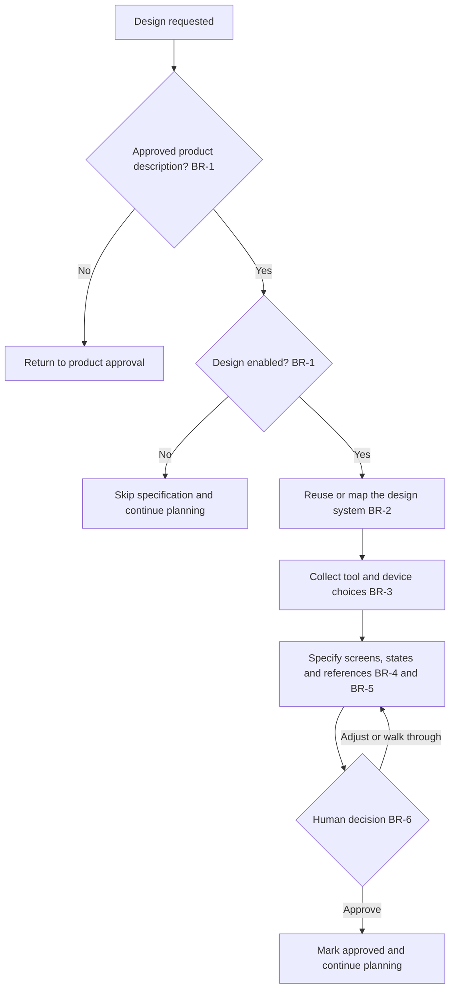
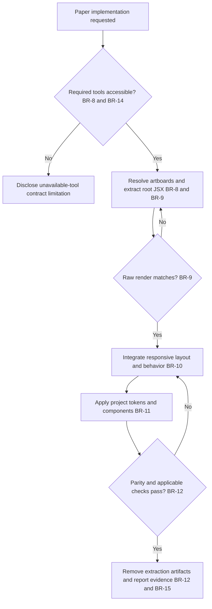

# Design Specifications and Artboard Implementation

## What

Hele turns approved product requirements into screen specifications for the human's chosen tools and devices. It reuses the consumer project's design system, records the states and interactions to implement, and asks for design approval before delivery proceeds.

For Paper designs, the implementation workflow extracts the actual artboards, preserves existing product behavior, adapts the design to the requested devices, verifies the result, and removes temporary extraction work. These capabilities are shipped agent instructions. This absorbed description records their current contract; it does not assert that a live design or implementation run passed validation.

## Why

The design agent's recorded mission is to leave a decision trail that an implementer can follow instead of inventing a layout. A reusable design-system map prevents later work from rediscovering the same tokens and components. The Paper workflow explicitly validates raw extraction before transformation so extraction defects can be distinguished from integration defects, and it preserves existing behavior while changing presentation. Motives for individual default values and mandatory tool/device questions are not recorded separately.

## Flows

### Specify and approve screens

An approved product description and the project's design setting determine whether screen design is needed. The human chooses tools and devices, reviews a complete specification, and either approves it or requests a revision.

| Branch | Rule |
|---|---|
| Draft product requirements return to their approval stop | BR-1 |
| Design disabled skips the specification | BR-1 |
| Missing or outdated design memory is mapped or refreshed | BR-2 |
| Tool and devices come from the human | BR-3 |
| A draft covers the applicable screens, states and source references | BR-4, BR-5 |
| Approval advances; adjustment and walkthrough preserve the draft stop | BR-6 |

### Implement a Paper reference

With accessible Paper references, the implementer validates the extracted source before responsive integration and verifies the final result before cleanup and completion. Unavailable-tool instructions conflict in the shipped contract; that path has an explicit limitation rather than a claimed successful fallback.

| Branch | Rule |
|---|---|
| Required references and access are resolved before extraction | BR-8 |
| Unavailable Paper/browser instructions do not establish one reliable fallback | BR-14 |
| A raw mismatch returns to extraction rather than being hidden by transformations | BR-9 |
| Integration preserves behavior and uses responsive design references | BR-10 |
| Refactoring uses the consumer project's tokens and components | BR-11 |
| Completion requires the stated checks, cleanup and honest evidence | BR-12, BR-15 |

## Business rules

### BR-1 — Design eligibility

Design requires initialized project memory and an approved product description. A draft product description returns to product approval. An explicit disabled design setting skips the specification and continues to planning, with a way to re-enable design reported. An absent enabled setting is treated as enabled. Disabling design in this repository does not remove the harness's ability to design screens for consumer projects.

### BR-2 — Reuse design-system memory

When configured design-system sources exist and their map is missing, design work creates a compact map of tokens, components, variants, states and principles. An existing map is reused. A human-reported change or a source mismatch triggers a refresh. Without configured paths, the agent asks once whether a design system exists; if none exists, it uses existing application patterns and states that basis in the specification.

### BR-3 — Ask for tools and devices

Before designing, collect both the design tool and target devices from the human. Supported choices include Paper, Figma, another named tool, or code references, and mobile, desktop and tablet devices. The specification records both answers. Neither choice is silently assumed.

### BR-4 — Cover the product's screens and states

The specification covers every user-facing flow of the approved product description and the applicable default, loading, empty, error and success states on the selected devices. It records components, interactions and accessibility requirements. Existing components are mapped to the design; a new component is identified with an explanation of why existing components do not suffice. Required sections contain actual decisions rather than empty placeholders.

### BR-5 — Preserve the visual source

Paper and Figma specifications create artboards and retain stable references for each screen and device. Another selected tool follows the human's instructions and supplies stable references. Code-reference design instead supplies explicit layout prose describing structure, hierarchy, regions, spacing, components and responsive behavior. Implementers obtain actual visual-tool data for artboard designs; screenshots are comparison evidence rather than the source used to reconstruct layout. The unavailable-tool exception remains subject to BR-14.

### BR-6 — Require explicit design approval

A new specification begins as a draft version 1.0 tied to its product-description version. The report identifies tool, devices, screens, components and references. The human can approve, request an adjustment, or request a screen-by-screen walkthrough. Approval marks the specification approved, updates its registry version and starts planning without another plan-approval stop. A requested revision does not constitute approval.

### BR-7 — Refresh stale design and preserve role boundaries

A specification based on an older product description is flagged as stale. Only affected screens are revised and the document patch version increases. Vega specifies designs and does not implement them or perform post-implementation design QA. Van Pelt implements the specification and reports deviations rather than silently replacing the layout or components.

### BR-8 — Resolve Paper inputs before implementation

The Paper-specific procedure checks access and loads the tool guide. It uses a supplied artboard identifier, otherwise the selected artboard, otherwise presents the available choices to the human. If a second mobile or desktop reference is missing, the human is asked; a confirmed single-artboard source is supported without pretending there are two layouts to merge. Required Paper access and browser access have conflicting fallback instructions documented in BR-14.

### BR-9 — Validate extraction before transformation

Extract the full root JSX once per artboard. Supplementary style, font and image queries are used only when needed. Render the unmodified extraction in temporary components and compare it to the source before merging or transforming it. A mismatch is corrected at extraction first. Temporary paths are tracked for later removal.

### BR-10 — Preserve behavior during responsive integration

Existing component properties, event handlers, references and public behavior stay intact. Annotation and metadata frames are excluded from product UI. Artboard viewport wrappers are removed. When both device references exist, their differences are combined into one responsive implementation that preserves desktop containers and avoids imposing mobile widths on desktop. Existing state, navigation, events and localization are integrated rather than replaced by a visual-only shell.

### BR-11 — Use the consumer project's design system

Discover tokens before implementation and map fonts during initial integration. Replace matching arbitrary values with established tokens, reuse existing components and extract repeated components when appropriate. Remaining off-scale pixel values use rem except one-pixel borders. Run affected tests through the refactor and preserve existing behavior. These are consumer-project obligations, not a request to create a local design system for this absorption.

### BR-12 — Verify and clean up before declaring completion

The Paper completion contract requires all five phases: extraction, responsive integration, refactoring, visual verification and cleanup. It requires comparison against Paper, including supplied interaction states, responsiveness and interactivity checks, removal of artboard artifacts and all temporary extraction files, and passing final applicable tests. A mismatch returns to correction; progress reports identify the completed and next phase. BR-14 prevents an unavailable-browser path from being described as proven parity.

### BR-13 — Do not modify Paper during implementation

The Paper-to-code workflow reads Paper references and does not write back to their artboards. This differs from the specification workflow, which can create design artboards. Choosing implementation does not authorize redesigning the source reference.

### BR-14 — Disclose the unavailable-tool contract limitation

The shipped instructions do not define one consistent outcome when visual tools are unavailable:

| Case | Conflicting current instructions | Absorbed interpretation |
|---|---|---|
| Chrome/browser unavailable | Paper pre-flight permits warning and skipped visual verification, while completion and verification phases require browser comparison | Preserve the conflict; visual parity is not validated without comparison |
| Paper unavailable | Paper pre-flight says stop, while the frontend persona permits implementation from specification text with a fidelity-gap disclosure | Preserve both instructions as a contract limitation; do not claim that either fallback has been executed successfully |

The human approved recording these limitations rather than changing the product during absorption. They are not newly invented fallback rules or completed validation evidence. Sources are `skills/hele-paper-to-code/SKILL.md` Pre-flight, Completion rule and Phases 1–5, and `agents/frontend-van-pelt.md` Implements from DESIGN_SPEC.

### BR-15 — Report engineering evidence honestly

The implementer owns behavior-level tests for changed product behavior and reports the relevant test, scenario and assertion mapping, command and result, code identity and mocked boundaries so QA can assess reuse. A skipped or unproven check is not reported passing. Source instructions and visual screenshots alone do not establish a successful implementation run.

## Scope

### In scope

- Conditional design, design-system reuse, tool/device selection and complete screen specifications.
- Explicit approval, stale-design updates and traceable references.
- Paper extraction, responsive integration, behavior preservation, visual verification and cleanup.
- Recorded limitations for unavailable visual tools and honest engineering evidence.

### Out of scope

| Left out | Why |
|---|---|
| A graphical application shipped by hele-skills | The repository ships agent workflows and a CLI, not a consumer app UI |
| A design-system map or new screen design for this absorption | The human disabled design for this repository |
| Resolving contradictory tool fallbacks | The approved snapshot records current behavior and gaps without product fixes |
| Claims of tested Paper/Figma or browser interaction | The survey did not execute those workflows; QA records the proof status separately |

## Glossary

| Term | Meaning |
|---|---|
| Consumer project | The application in which the Hele harness is used |
| Artboard | A named visual source for a screen and device in the chosen design tool |
| Visual parity | A comparison demonstrating that the implemented view matches the source reference |

## Changelog

- v1.0 (2026-11-18) — absorbed from the app. Slices: 001-specify-screens (BR-1, BR-2, BR-3, BR-4, BR-5, BR-6, BR-7); 002-implement-paper-artboards (BR-8, BR-9, BR-10, BR-11, BR-12, BR-13, BR-14, BR-15).
