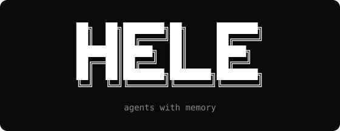

A feature-delivery harness for Claude Code. One command: `/hele`. It picks the lane and runs the rest.

📚 **[Full documentation](.docs/README.md)** with introduction, getting started, skills and CLI references · [Changelog](CHANGELOG.md)

**Core belief:** agents have no memory, so we build it for them. Every feature leaves behind documents that explain WHAT it is and WHY it exists, HOW it was built, and HOW to validate it. Future sessions read those documents instead of guessing.

Work is organized in tasks using [beads](https://beads.gascity.com/) (`bd`), [Steve Yegge](https://github.com/steveyegge)'s dependency-aware issue tracker built for agents. Hele runs on it under the hood: every planned task becomes a beads issue, the build loop dispatches whatever `bd ready` unblocks, and an interrupted session resumes exactly where it stopped, the state lives in beads, not in the chat, allowing work with multiple sub-agents in an organized way.

## How you use it

One command called `/hele <your prompt>`. Agent Lisbon, the Builder, detects the lane and runs the rest:

| Lane             | When                                                                  | What happens                                                                                                                                                                                                     |
| ---------------- | --------------------------------------------------------------------- | ---------------------------------------------------------------------------------------------------------------------------------------------------------------------------------------------------------------- |
| The Feature Lane | The product does not do this yet. This part of the app doesn't exist. | Questions until none remain, then PRD + stubs + increment `001`, design when there is a new screen (optional), and the team plans, builds, and auto-verifies on its own providing you screenshots of the result. |
| The Fast Lane    | A small addition to what already exists, a product increment.         | Asks questions if necessary, then a PRD patch an update and create a new increment for your feature.                                                                                                             |
| The Bugfix Lane  | Today's behavior is wrong.                                            | Asks questions if necessary, reconciles the docs, and follows the same spine of the fast lane.                                                                                                                   |
| The Open Lane    | Research, review, investigation, design exploration, anything else.   | A conversation, with no PRD, until you pick **Let's formalize or say you're done.**                                                                                                                              |

## Install

```bash
claude plugin marketplace add guscsales/hele-skills
claude plugin install hele-skills@hele -s project   # this repo, shared with the team
```

Later, `/hele-update` brings that install to the latest version.

## The vision

Everyone is talking about AI and coding agents. After some time reflecting, I reached a surprising conclusion: in terms of software engineering structure, nothing changed. What changed is the scale and who operates that structure. It used to be a boss with **10 humans on the team**. Now it's a programmer with **10 agents on the team**.

See if this looks like your context as a Software Engineer at a tech company:

> There is a task. A product manager understands the what, the why, and how to validate that feature. Along the way they ask a lot of questions to the people involved: sales, the customer themselves, the company's leadership and so on. In many cases they still don't talk to you directly. In the end, the PM consolidate everything into a file known as a *"Product Requirement"*, *"PRD"*, *"Product Scope"*, *"Epic"*. It has plenty of fancy names.
>
> Once that exists, the staff engineer (or the engineering manager) picks up the file, understands it (or goes back to product with questions) and, together with the team, splits the work across frontend, backend, design, infra - whatever it takes. Now the group has its tasks and executes like a conductor coordinating an orchestra. When someone gets stuck, it escalates to the manager, the staff engineer, or product. If that person can't solve it either, they go find the answers and come back with direction. The cycle repeats until what needs to be done is finally done.
>
> At the end, a QA person (or the CI itself) validates what was built: opens the browser, tests it. The product person does that job too. Bottom line: input ↔ output. Feature delivered.
>
> The next step is talking about it. The famous retrospective. Like any decent agile team, at the end of the cycle everyone sits together and reviews what worked, what didn't, which instruction was ambiguous, which step caused rework, and plenty more. Everyone leaves knowing a bit more than when they came in, and the next cycle costs less.
>
> We repeat it from the beginning.

Going back to the world of AI and agents. My question is: why should this flow be any different? It shouldn't. The difference is that now that whole team is you and several Claude Codes (or other code agents) running together.

Hele Skills Solves That. Welcome to you next level of creation.

## The flow — one command, `/hele`. The rest comes from the agent.

```
 ╭─ You ──────────────────────────────────────── START ─╮
 │ /hele "what you need"                                │
 │ One command. It picks the lane and runs the rest.    │
 ╰──────────────────────────────────────────────────────╯
    │
    ▼
 ╭─ It detects the lane ────────────────────────────────╮
 │ Feature   questions, then PRD + stubs + 001          │
 │ Fast      questions when a rule would change         │
 │ Bugfix    questions only when the rule changes       │
 │ Open      research, review, investigation, design    │
 ╰──────────────────────────────────────────────────────╯
    │  feature / fast / bugfix — /hele runs these
    ▼
 ╭─ questions ─────────────────────────────────── STOP ─╮
 │ Agent Lisbon                                         │
 │ ▸ answer every product question before a write       │
 │ ▸ a recommendation is an option, not a rule          │
 ╰──────────────────────────────────────────────────────╯
    │  zero unanswered product questions
    ▼
 ╭─ PRD + stubs ──────────────────────────── SAME STOP ─╮
 │ Agent Lisbon + Agent Wylie                           │
 │ ▸ PRODUCT_DESCRIPTION.md + TEST_STUBS.md             │
 │ ▸ PRD delta: was → now, clickable file links         │
 ╰──────────────────────────────────────────────────────╯
    │
    ▼
 ╭─ design (only if new screens) ──────────────── STOP ─╮
 │ Agent Vega · skipped when no new screens / no design │
 │ ▸ DESIGN_SPEC.md                                     │
 ╰──────────────────────────────────────────────────────╯
    │  approved PRD, and design when this stop happened
    ▼
 ╭─ agents ─────────── plan · build · auto-verify ──────╮
 │ Lisbon · EXECUTION_PLAN.md + beads · no sign-off     │
 │ Cho, Van Pelt, Jane, Rigsby · code + passing tests   │◄──┐
 │ Wylie · Playwright + screenshots + QA_REPORT.md      │   │
 ╰──────────────────────────────────────────────────────╯   │
    │ report ready                                          │
    │     ╭─ QA red / generate-fixes-report ───────────╮    │
    │     │ approve fixes → build + auto-verify again  │────┘
    │     ╰────────────────────────────────────────────╯
    ▼
 ╭─ QA report ─────────────────── YOUR NEXT PROMPT ─────╮
 │ Continue to manual verify, or fix what you saw       │
 ╰──────────────────────────────────────────────────────╯
    │ continue
    ▼
 ╭─ manual verify ──────────────────────────────────────╮
 │ Agent Wylie + you                                    │
 │ ▸ tables: how to open, the data, each step           │
 │ ▸ same proof as QA_REPORT → VERIFY.md                │
 ╰──────────────────────────────────────────────────────╯
    │
    ▼
 ╭─ close ────────────────────────────────────────────╮
 │ Work done · adjust this increment · draft PR       │
 ╰────────────────────────────────────────────────────╯

 ╭─ always ───────────────────────────────────────────╮
 │ First time in a repo → init runs by itself         │
 │ Stops: questions, PRD, design, DB schema,          │
 │ QA report, verify, close. Plan is for agents.      │
 │ A verify fix goes back to the PRD phase            │
 │ Flow runs again. Passed walks stay passed          │
 │ Open lane stays a conversation until formalize     │
 ╰────────────────────────────────────────────────────╯
```

### Output is everything: instead of skills you have stops

All the outputs are well defined. You know what is happening, and what your next decision is. It can be a question, the PRD, or the QA report.

Real stops end in numbered options: `1` approves and starts the next phase; `2` is tell me what you need. When an open lane finishes, the close includes **Work done** or **Let's formalize in a real PRD**.

The QA agent writes a human-readable `QA_REPORT.md`: the screen before this increment and after it, then a replay. Each replay is three tables: how to open the page, the data the run used, and the steps. When the report is ready, you choose: continue to the manual walk, or fix something you saw. The walk copies those tables, one flow at a time, with the screenshot of what pass looked like.

Every file in a chat table is a clickable link. The label is the file name. The target is the absolute path, on one line. A raw path in a column wraps and stops being a link.

### A fix during the walk goes back to the PRD

When you are in the manual walk and something needs a fix, Lisbon goes back to the PRD on that same increment, updates it, and the flow runs again. A flow you already marked pass is not shown again, unless that fix changed it. She does not open a new feature for that correction.

## The agent team

You talk to Lisbon in the main session. She is the Builder: product manager and staff engineer. The heavy work (review, the suite, artifacts, reading code) goes to background subagents.

| Agent | Role |
| --- | --- |
| Lisbon | The Builder. Owns the PRD, the plan, and the dispatch. |
| Vega | The designer. UI spec when there is a new screen. Optional. Paper, Figma, or a code reference. |
| Cho | Backend. |
| Van Pelt | Frontend, from the design spec. |
| Hightower | The DBA. A schema change stops and asks for your approval before any migration. |
| Jane | Security. Threat model on risky increments. |
| Rigsby | Infra. CI, deploys, YAML. |
| Wylie | QA. Writes the stubs, runs Playwright, takes the screenshots, and walks you through the same steps in tables. |
| Summer | Build until pass. Fixes the project compile until it is green. |

You answer what the agents cannot know, and you pick the numbered options.

Defaults live in `.hele/settings.json` (`agents.models`). Judgment sits on the strong model. Execution volume sits on the cheaper one. Change one with `hele config set agents.models.backend-cho.claude-code opus`.

| Agent | Key | Claude Code | Cursor |
| --- | --- | --- | --- |
| Lisbon (Builder) | `staff-lisbon` | opus | grok |
| Lisbon, suite | `staff-lisbon-run` | sonnet | composer |
| Vega (Design) | `design-vega` | opus | opus |
| Hightower (DB) | `dba-hightower` | sonnet | grok |
| Cho (Backend) | `backend-cho` | sonnet | composer |
| Van Pelt (Frontend) | `frontend-van-pelt` | sonnet | composer |
| Jane (Security) | `security-jane` | opus | grok |
| Rigsby (Infra) | `infra-rigsby` | sonnet | composer |
| Wylie (Writing Stubs) | `qa-wylie-stubs` | opus | grok |
| Wylie (Running tests) | `qa-wylie-run` | sonnet | composer |
| Summer (Build checker) | `staff-lisbon-run` | sonnet | composer |

## Project layout (created by /hele-init)

```
.hele/
  settings.json            # models, max agents, design system paths
  index.json               # registry of features (slug, aliases, doc versions)
  DESIGN_SYSTEM.md         # Vega's map of the design system, when one exists
  DATABASE.md              # Hightower's living schema map
  features/
    <slug>/
      PRODUCT_DESCRIPTION.md   # living doc — current product, patch versions only
      TEST_STUBS.md            # living doc — written with the PRD
      increments/
        001-<name>/
          EXECUTION_PLAN.md    # per-increment, for the agents
          DESIGN_SPEC.md       # when UI is involved
          DB_CHANGES.md        # when the DB is touched — blocking approval
          QA_REPORT.md         # the run, with open / data / steps tables
          VERIFY.md            # the same tables, plus your verdicts
          screenshots/         # up to 10 settled PNGs
```

There is no `state.json`. The feature is the folder. The increment is the folder this run is building. Beads hold the open tasks.

## Versioning rules

- Docs carry `version` in frontmatter plus a `## Changelog` section. **Patch-only** (1.0 → 1.1 → 1.2).
- A ground-up rebuild is **a new feature folder**, never a major bump.
- Derived docs carry `based_on: PRODUCT_DESCRIPTION vX.Y`. When the PRD moves, the next plan or spec reconciles before it builds.
- `PRODUCT_DESCRIPTION` is written as **state, not history**: superseded rules are rewritten, not appended. History lives in the changelog and git. Sections are `## What`, `## Why`, `## Flows`, `## Business rules`, and so on.
- A document can be `draft` until you approve it (the PRD, a design spec, a schema change). That is the signature on the file. It is not a status board for the feature.

## Finding features (anti-duplicate)

Skills never grep ad hoc. They search through `hele find` against `index.json` (slug, title, aliases in EN/PT, summary) with content fallback, and the Feature lane has a hard gate: no new feature is created before searching and confirming with the human that it is not an update to an existing one.

## Working from local clone (contributors)

```bash
claude plugin marketplace add /path/to/hele-skills
claude plugin install hele-skills@hele -s project
```

## CLI

Node CLI built with [commander](https://github.com/tj/commander.js) — Claude Code runs on Node, so every hele user already has the runtime. The bundle (`cli/dist/hele.cjs`) is committed: the plugin needs no `npm install` at runtime.

```
hele ai [skill]          understand the AI workflow — skills, agents, artifacts
hele find <query...>     search the feature index (agents MUST use this, never ad-hoc grep)
hele find --list         list all registered features
hele config get|set|add  read/write .hele/settings.json by dot path
hele install [--check]   install bd if needed, then init the project database
hele --help              banner + full listing
```

Use it directly in your terminal:

```bash
cd cli && npm link        # dev setup — `hele <command>` anywhere
# once published: npm i -g hele-cli
```

Contributing: edit `cli/src/`, then rebuild and commit `cli/dist/hele.cjs` (`cd cli && npm run build`). CI fails if that bundle is stale. The plugin skills live in `skills/` / `agents/` / `templates/` — Claude Code only.
