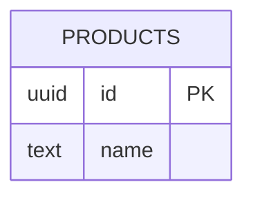
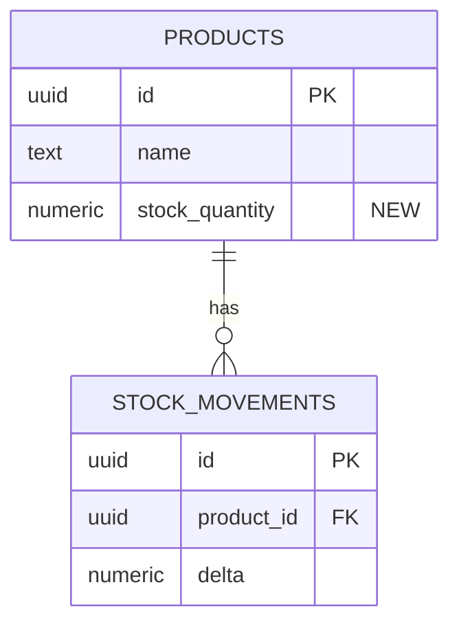

<!-- RULES:
- Owned by [AGENT DBA] Hightower. Required whenever an increment touches
  schema, indexes, backfills, or production seeds. New queries against
  existing structures do NOT require this file.
- Human-readable markdown ONLY. No XML section tags. A person opens this
  file and understands the schema delta: what exists, what changes, how
  to roll it back, and what can lock or lose data. Agents find sections
  by the ## / ### headings below.
- The same DB-n list is copied into EXECUTION_PLAN.md under ## Database
  in the same turn. The plan is not done while those two lists differ.
  A later patch updates both files together.
- human approval of this doc is BLOCKING: build does not start while
  this is draft, and /hele-build will not dispatch migration tasks
  without it. The EXECUTION_PLAN is for the agents — it is not a sign-off.
- Changes are numbered (DB-n). Each cites the plan task or business
  rule that needs it. Irreversible operations are flagged in bold.
- After the migration is applied, Hightower updates the living map
  .hele/DATABASE.md to the new current state.
-->
---
feature: <slug>
doc: DB_CHANGES
increment: NNN-<increment-slug>
version: "1.0"
based_on: PRODUCT_DESCRIPTION vX.Y
status: draft # draft | approved
updated: YYYY-MM-DD
---

# DB Changes — <increment title>

## Current state

The affected slice of today's schema, taken from `.hele/DATABASE.md`. Name the tables, the columns this increment relies on, and the indexes that already exist. Say what is absent.

## Proposed

The same slice after this increment. Mark new columns and new tables in the diagram.

## Changes

| Id | Change | Why |
|---|---|---|
| DB-1 | DDL with enough precision to write the migration | T1 / BR-n |
| DB-2 | ... | ... |

## Data migration

Backfills, seeds, and transformations, with a volume estimate. "None" is a valid answer.

## Rollback

How to revert each DB-n.

**IRREVERSIBLE:** flag any change that cannot be rolled back (a dropped column that held data, a destructive backfill). Those need an explicit yes from the human.

## Risks

| Id | Risk | Mitigation |
|---|---|---|
| R-1 | Lock, size, or ordering risk | Deploy code before migrating, or build the index concurrently |

## Changelog

- v1.0 (YYYY-MM-DD) — initial version
